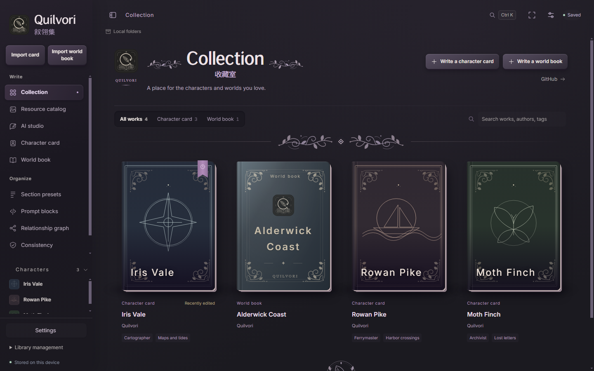
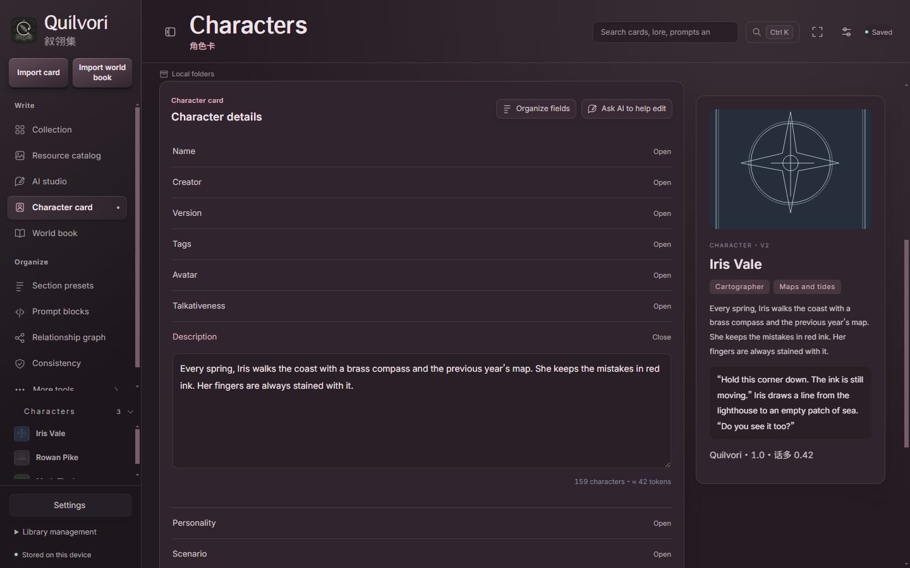
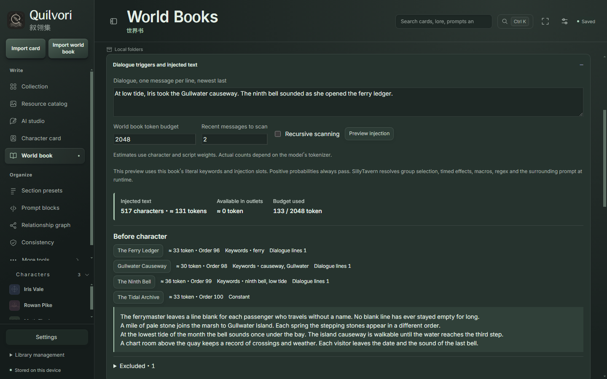

<p align="center"></p>

# Quilvori · 叙翎集

캐릭터와 세계를 쓰고, 뒤섞인 설정을 다시 꺼내 쓰기 좋게 정리하는 로컬 작업 공간입니다. ✍️

[English](README.md) · [中文](README.zh.md) · [日本語](README.ja.md) · [Русский](README.ru.md) · **한국어** · [ไทย](README.th.md)

Quilvori는 SillyTavern용 자료를 만드는 도구입니다. 캐릭터 카드와 월드북을 편집하고, 직접 연결한 모델과 원고를 다듬은 뒤 SillyTavern으로 내보낼 수 있습니다. 수동 편집, 가져오기, 로컬 검사, 백업은 독립적으로 사용할 수 있습니다. AI 기능에는 별도로 설정한 모델 서비스가 필요합니다.

## 화면 미리보기

가상의 예시 작품으로 컬렉션, 캐릭터 편집기와 월드북 발동 미리보기를 보여 줍니다.

<a href="docs/screenshots/collection.png"></a>

<table>
  <tr>
    <td width="50%"><a href="docs/screenshots/character-editor.png"></a></td>
    <td width="50%"><a href="docs/screenshots/world-book-trigger.png"></a></td>
  </tr>
  <tr>
    <td align="center">캐릭터 편집기</td>
    <td align="center">월드북 발동 미리보기</td>
  </tr>
</table>

## 컬렉션, 페이지 색상, 리소스 목록

표지 제목 옆의 핀을 눌러 자주 쓰는 캐릭터 카드나 월드북을 책장 맨 앞에 고정하세요. 고정을 해제하면 원래 순서로 돌아갑니다. 고정 상태는 라이브러리 백업에 저장되며 SillyTavern용 파일에는 포함되지 않습니다.

홈에서는 캐릭터 초상과 월드북 표지를 크게 진열합니다. 검색, 종류별 필터, 원문 미리보기, 카드와 월드북 작성 입구가 있습니다. 초상이 없으면 글자 표지를 사용하며 작가의 그림을 대신할 이미지를 생성하지 않습니다. 책 장식 테두리, 모서리 무늬와 장서인이 분위기를 더합니다.

페이지별로 차분한 색상을 사용합니다. 컬렉션은 연보라, AI는 청보라, 캐릭터는 로즈 그레이, 월드북은 세이지, 글쓰기 도구는 샴페인, 구조 도구는 슬레이트 블루, 읽기는 따뜻한 갈색, 서사는 자두색, 소재와 리소스는 스모키 핑크, 관리 도구는 흑연색입니다. 외관 및 언어 설정에서 페이지별 색상과 사용자 지정 색상을 바꿀 수 있으며 저장된 사용자 색상은 유지됩니다.

새 프로필의 기본 언어는 영어입니다. 업데이트해도 기존에 저장한 지원 언어는 그대로 유지됩니다. 중국어·영어·일본어·러시아어·한국어·태국어를 지원하며, 언어 전환은 작품 본문이나 작가명을 번역하지 않습니다.

리소스 목록에서는 작가의 원본 미리보기 이미지, 이름, 소개, 원문 링크와 이용 조건을 확인합니다. 카드·월드북·배경화면을 다루며, 개인 라이브러리의 복제본이나 임의의 Discord 게시물을 자동 검색하는 기능이 아닙니다. 원문을 보려면 본인 계정과 서버 접근 권한이 필요할 수 있습니다. 마음에 드는 작품은 원문 댓글로 작가를 응원해 주세요. 앱이 대신 댓글이나 메시지를 보내지는 않습니다.

재배포 허가가 확인되지 않은 항목에는 작품 파일을 포함하지 않습니다. 원문에서 첨부 파일 링크를 복사해 가져오세요. 카드 PNG/JSON과 월드북 JSON은 미리보기 후 저장하며 다운로드 한도는 12 MB입니다. 웹에서는 CORS 제한이 적용되고 Discord 링크가 만료되면 다시 복사해야 합니다. 배경화면은 PNG/JPEG/WebP만 지원하며 입력 한도는 12 MB, 각 변 8192픽셀, 총 4000만 픽셀입니다. 로컬 저장본은 긴 변 1600픽셀, 500 KB 이하로 줄어듭니다. 고해상도 원본은 작가에게서 받으세요. SVG, 웹페이지, 테마 파일은 배경화면으로 가져오지 않습니다.

정리된 작가·원문 정보는 편집기의 접이식 영역과 카드/월드북 내보내기의 `quilvori_source` 확장에 보관됩니다. 공개되어 있다고 재배포가 허용되는 것은 아니며, 저장소의 GPLv3 라이선스가 타인의 작품에 자동 적용되지 않습니다. 기여 전 영어 [기여 안내](CONTRIBUTING.md)를 읽어 주세요.

## 할 수 있는 일

- 설명, 성격, 시나리오, 첫 인사, 대화 예시, 역할 지침을 편집하고 바로 미리 봅니다.
- 한 필드에 섞인 자료를 원문 그대로 옮기며 기존 대상 필드의 내용도 보관합니다.
- 이름 없는 월드북 항목에 이름, 분류, 정확한 주 키워드를 제안하고 본문은 유지합니다.
- 선택한 필드, 항목 또는 텍스트 구간만 AI로 수정하고 전후 비교 후 적용·취소합니다.
- 채택한 아이디어와 현재 초안을 바탕으로 대화하며 계속 수정합니다.
- 설정, 사실, 시간선을 검사하고 인용문과 읽기 쉬운 원문 위치를 확인합니다.
- 프롬프트, 정규식, 빠른 답장, 관계도, 시간선, HTML 메모리를 관리합니다.

### SillyTavern 테마 공방

테마 공방에서 JSON 파일을 열거나 Discord 원문 및 첨부 링크를 붙여 넣으세요. Selenis의 Lavender Blossoms, Dascard의 Inkflow Radiance(PC), GrizzyBurr의 Solarized Light에 원문 링크와 작가 이름이 표시됩니다. 기기에 사본이 없으면 원문에서 받을 수 있습니다. 색·투명도·흐림과 배경을 미리 보고, 작가 CSS와 출처가 포함된 ST JSON을 내보낼 수 있습니다.

데스크톱 버전에서 SillyTavern 설치 폴더, data 또는 사용자 폴더를 입력하고 대상을 선택하면 기존 테마를 읽고 전환하거나 수정한 사본을 설치할 수 있습니다. 열려 있는 SillyTavern 탭은 새로고침하세요. 적용 시 작가의 CSS를 사용할지 직접 선택합니다. 배경과 Info Board는 별도 리소스입니다.

## 빠른 시작

저장소를 다운로드하거나 Git으로 복제합니다.

```bash
git clone https://github.com/ShangguanQian/Quilvori.git
cd Quilvori
```

### 웹 버전

Python 3과 최신 브라우저가 필요합니다. 웹 버전에는 npm 의존성 설치나 빌드 과정이 없습니다.

```bash
python3 -m http.server 8765 --bind 127.0.0.1
```

Windows에서는 다음 명령도 사용할 수 있습니다.

```powershell
py -m http.server 8765 --bind 127.0.0.1
```

[http://127.0.0.1:8765/](http://127.0.0.1:8765/)을 열고 사용하는 동안 서버를 실행해 두세요. 포트가 사용 중이면 다른 포트를 선택할 수 있지만, 포트가 달라지면 브라우저 자료실도 별개입니다.

`index.html`을 직접 여는 방법도 있습니다. 브라우저가 파일 페이지의 저장소나 API 요청을 제한하면 로컬 HTTP 서버를 사용하세요. 저장할 수 없는 상태로 페이지를 닫기 전에는 전체 백업을 내보내세요.

### 데스크톱 버전

0.2부터 Windows x64 버전은 두 번 클릭하면 실행되는 단일 `.exe` 파일입니다. Mac에서는 Apple 실리콘용 `arm64` 또는 Intel용 `x64` 디스크 이미지를 선택하세요. `.dmg`를 열고 **Quilvori**를 응용 프로그램 폴더로 옮겨 실행하세요. 두 버전 모두 Electron을 포함합니다. [릴리스 다운로드](https://github.com/ShangguanQian/Quilvori/releases)

#### 소스에서 실행

Node.js 22.12 이상과 npm을 준비한 다음 저장소 루트에서 실행합니다.

```bash
npm ci
npm start
```

Windows에서는 의존성을 설치한 뒤 저장소의 [Start-Quilvori.cmd](Start-Quilvori.cmd)를 더블 클릭해도 됩니다. 스크립트 위치를 기준으로 프로젝트를 찾아 다른 작업 폴더에서 호출해도 실행됩니다. 프로세스 실행에 성공하면 명령 창을 닫고 실패하면 오류를 보여 준 채 대기합니다. Node.js 22.12 이상이 필요합니다. 의존성이 없으면 프로젝트에서 `npm ci`를 실행하도록 안내하며, 자동 다운로드나 전역 Electron 대체 실행은 하지 않습니다.

데스크톱 버전에서는 직접 선택한 폴더의 카드와 월드북을 읽을 수 있습니다.

## 처음 사용할 때

1. 새 자료실에는 「听雨楼」 예제가 표시됩니다. 편집, 검사, 내보내기를 연습할 수 있으며 「未名客」은 일부 필드를 비운 초안입니다.
2. 사이드바에서 캐릭터 JSON/PNG 또는 월드북 JSON을 가져옵니다. 해당 페이지에 파일을 끌어 놓아도 됩니다.
3. 캐릭터의 필드 정리 또는 월드북의 AI 항목 정리로 기존 자료를 먼저 정돈합니다.
4. 내용을 고쳐 쓰려면 AI 창작의 기존 자료 수정에서 정확한 범위를 선택하고 요청을 적습니다.
5. 제안을 확인하고 필요한 것만 적용한 뒤 SillyTavern으로 내보내고 전체 백업도 보관합니다.

예제 불러오기와 자료실 비우기에는 확인 절차가 있습니다. 예제를 다시 불러오면 현재 자료실을 교체하므로 본인 자료를 먼저 백업하세요.

## AI 모델 연결

설정의 모델 연결 화면에서 다음을 진행합니다.

1. `https://api.openai.com/v1` 같은 서비스의 API 기본 주소를 입력합니다. 개별 요청의 전체 엔드포인트 주소를 넣지 않습니다.
2. 본인의 API 키와 프로토콜을 선택하고 연결합니다.
3. 서비스가 반환한 목록에서 모델을 고릅니다. 짧은 테스트 메시지로 연결을 확인할 수 있습니다.
4. 필요하면 추론 강도를 선택합니다. 기본값은 추가 추론 매개변수를 보내지 않으며, 지원 단계는 모델과 서비스마다 다릅니다.

OpenAI 호환 **Responses**와 **Chat Completions**를 지원합니다. 자동 모드는 Responses를 먼저 시도하고 엔드포인트가 지원되지 않을 때 전환합니다. Chat Completions만 제공하는 서비스라면 해당 방식을 직접 고르세요. 인증 실패와 잘못된 응답은 오류로 표시합니다.

추론 강도가 높으면 보통 시간이 더 걸립니다. 지원하지 않는 단계라면 모델 기본값이나 지원 단계로 바꾸세요. 사용 가능 여부, 출력 품질, 요금은 연결한 모델 서비스에 따라 달라집니다.

각 모델 프로필에서 데이터 수신 대기 시간을 1~60분으로 설정할 수 있습니다. 기본값은 5분이며, 데이터가 들어올 때마다 다시 계산합니다. 작업 기록에서 첫 응답을 기다리다가 시간이 지났는지, 수신 도중 전송이 멈췄는지 확인할 수 있습니다.

수동 작업은 오프라인으로 할 수 있습니다. AI 생성·정리·대화·검사를 요청하면 선택한 원문, 참고 자료, 지시, 관련 대화가 설정한 API로 전송됩니다. 데스크톱 앱은 Windows 사용자 보호 또는 macOS 키체인으로 모델 키를 암호화합니다. 웹에서는 IndexedDB에 보관한 내보낼 수 없는 Web Crypto 키를 사용합니다. 마이그레이션은 모든 키가 복호화되는지 확인한 후 이전 설정을 교체합니다. 모델 키는 카드와 자료실 백업에 포함되지 않습니다.

## AI 작업 방식

### 기존 자료 수정

캐릭터나 월드북을 고른 뒤 수정할 필드 또는 항목을 선택합니다. 원문 일부를 선택해 그 구간만 바꿀 수도 있습니다. 다른 자료는 참고로 사용하며 결과는 수정 전후 비교로 표시합니다.

응답에서 빠진 필드는 원래 값을 유지합니다. 기존 내용을 비우려면 별도 허용이 필요합니다. 추가 질문, 불완전한 응답, 범위 밖 수정, 요청 중 원고 변경이 생기면 원고를 그대로 덮어쓰지 않습니다. 실행 취소도 이후의 수동 편집을 덮어쓰지 않도록 확인합니다.

### 새 초안 작성과 이어 쓰기

아이디어를 적고 작성을 시작하세요. 질문에 답하거나 제안된 아이디어를 고르는 단계는 선택 사항입니다. 작성한 답변과 선택한 아이디어만 생성에 반영됩니다.

창작 대화에서는 현재 초안과 채택한 아이디어를 함께 참고합니다. 생성, 대화, 정리, 검토가 진행되는 동안 같은 창에서 다른 페이지를 열 수 있습니다. 작업을 시작한 작품으로 돌아가면 진행 상황이나 결과를 볼 수 있습니다. 캐릭터 카드와 월드북은 선택한 필드나 항목만 다시 수정할 수도 있습니다.

새 캐릭터 카드와 월드북은 이 기기에 초안으로 저장됩니다. 컬렉션이나 해당 편집기의 ‘검토할 AI 초안’에서 내용을 확인하고 적용한 뒤 ‘컬렉션에서 열기’를 누르면 저장된 작품으로 이동합니다. 새 캐릭터를 참조하는 그룹, 대본, 관계도를 적용할 때는 캐릭터 카드를 먼저 적용하세요.

모델이 캐릭터 카드와 월드북을 한 번에 보내면 선택한 작품을 각각 검증합니다. 한 작품에 오류가 있어도 유효한 작품은 초안으로 남습니다. 기본적으로 카드·월드북 요청의 최근 기록 24개를 이 기기에 저장합니다. 본문이 없으면 요청의 종료 상태를 기록합니다. ‘생성된 작품’에서 각 초안이나 수록한 작품을 열 수 있습니다. AI 창작 화면의 작업 기록에서 초안을 복구하거나 이전 버전에서 복사한 원문을 붙여 넣을 수 있습니다. 복구는 기기에서 처리합니다. 대화는 일반 텍스트 답변도 지원하며, 최근 답변을 바탕으로 바로 초안을 수정할 수 있습니다.

### 논리와 캐릭터 설정 검사

로컬 규칙과 AI 검사는 따로 표시합니다. 보고서는 쉬운 결론, 이유, 처리 제안을 담고 카드 필드 또는 「월드북 → 항목 → 필드 → 줄」 주소로 근거를 표시합니다.

원문을 확인한 뒤 보고서로 돌아올 수 있습니다. 보고서는 생성 당시의 인용 위치를 보관하며 원고가 바뀌면 다시 검사하도록 알려 줍니다. 선택 필드의 빈칸은 참고 사항으로 표시합니다. 충돌로 표시하려면 원문에서 위치를 확인할 수 있는 서로 다른 구절이 두 곳 이상 필요합니다. 인용이 하나뿐이거나 인용 범위가 겹치면 보고서와 내보낸 JSON 모두에 확인이 필요한 항목으로 표시됩니다. 검사 자체는 원고를 수정하지 않습니다.

큰 월드북은 선택한 항목별로 나누어 검사할 수 있으며 범위를 명시합니다. 작업 기록은 상태, 서비스가 반환한 추론, 결과를 분리하고 추론이 없으면 없다고 표시합니다.

## 캐릭터 카드 필드 정리

캐릭터 편집 화면에서 필드 정리를 열고, 원하는 분류 기준을 적은 뒤 미리보기를 요청합니다.

- 설명, 성격, 시나리오, 첫 인사, 대화 예시, 시스템 프롬프트, 기록 후 지침, 작성자 메모를 대상으로 합니다.
- 이동마다 출발 필드, 대상 필드, 이유와 전후 내용을 확인합니다.
- 원문을 그대로 옮겨 기존 대상 내용 뒤에 추가합니다. 선택하지 않았거나 판단하기 어려운 자료는 원래 자리에 남습니다.
- 출발지에서 제거하는 작업과 대상에 추가하는 작업을 함께 적용합니다. 인용 불일치, 겹치는 구간, 원고 변경이 있으면 적용하지 않습니다.

이 기능은 기존 자료를 정리하며 없는 과거사를 만들지 않습니다. 제안한 분류를 직접 확인하고 필요 없는 선택 필드는 비워 두세요.

## 월드북 이름·분류·키워드 정리

현재 항목, 이름이 없거나 트리거가 부족한 항목, 현재 월드북 전체를 선택할 수 있습니다. 항목 편집 화면에서도 한 항목만 정리할 수 있습니다.

- 인물, 관계, 장소, 조직, 규칙, 역사, 물품, 줄거리, 기타로 분류합니다. 목록을 내용 분류별로 묶을 수 있습니다.
- 기본적으로 이름 없는 항목과 새 항목만 이름을 보충합니다. 기존 이름 변경은 따로 허용합니다.
- 주 키워드는 본문이나 원래 이름에서 고릅니다. 새 단어만 추가하고 기존 주 키워드와 보조 키워드는 보관합니다.
- 상시 활성 항목은 키워드가 없어도 됩니다. 활성화 방식 변경은 별도 허용 옵션을 켰을 때만 제안합니다.
- 키워드 방식으로 전환하려면 주 키워드가 최소 하나 필요합니다. 본문, 활성 상태, 선택 조건, 삽입 위치, 깊이, 순서는 정리 작업이 초기화하지 않습니다.

각 제안에는 원문 근거와 이유가 있습니다. 항목별로 선택해 적용하고 취소할 수 있습니다. 분류는 일반·내장 월드북의 `realmweave_category` 확장 필드로 내보내며 SillyTavern의 활성화 설정을 대신하지 않습니다.

## 페이지와 도구

| 페이지 | 용도 |
| --- | --- |
| 컬렉션 | 큰 표지, 검색·필터, 원문 미리보기와 작성 입구. |
| 리소스 목록 | 작가와 원문을 확인하고 카드·월드북·배경화면을 미리 본 뒤 가져오기. |
| 캐릭터 카드 | SillyTavern 필드 편집과 JSON·카드 PNG 입출력. |
| 월드북 | 항목·삽입 설정, 트리거 검사, 위치·내용별 목록. |
| AI 창작 | 선택 수정, 새 초안, 대화, 검사, 적용 미리보기. |
| 문단 프리셋 | 문체, 시점, 관계, 경계, 출력 형식 구성. |
| 프롬프트 구성 | 프롬프트 블록의 순서와 사용 여부. |
| 그룹 캐스트 | 인물, 시나리오, 말수와 발언 방식. |
| 채팅 읽기 | JSONL·메시지 배열, 검색, 북마크, 복사. |
| 자료 | 아바타, 표정, 배경을 자료실에 저장. |
| 정규식 스크립트 | 원문과 원하는 결과를 적고 필요하면 그대로 둘 예시를 추가합니다. 오프라인 서식으로 시험하거나 AI에 규칙을 요청한 뒤 Regex 확장용으로 내보냅니다. |
| 빠른 답장 | 범용 답장을 만들거나 참고할 캐릭터 카드와 월드북을 지정합니다. 관련 항목을 찾아 쓰거나 직접 선택한 뒤 버튼과 문구를 확인하고 Quick Reply v2로 내보냅니다. |
| 이야기 노트 | 장면을 계획하거나 가져온 채팅 메시지에 메모와 사건을 연결합니다. 노트에서 원문 메시지를 열 수도 있고, 메시지에서 연결된 노트로 이동할 수도 있습니다. |
| 관계도 | 인물·연결선을 편집하고 월드북으로 내보내기. |
| 일관성 검사 | 로컬·AI 보고서와 원문 이동. |
| 그룹 대본 | 대사, 서술, 트리거를 순서대로 구성. |
| HTML 메모리 | JS-Slash-Runner용 HTML 메모리 작성. |
| 전체 백업 | 자료실 내보내기, 교체·병합 복원. |
| 사용 안내 | 작업 방법과 내보낸 파일의 사용 위치. |

모양, 언어, 창작 선호 사항, 모델은 설정에 있습니다. 중국어 화면에는 로컬 Sarasa 글꼴을 사용합니다. 인터페이스는 여섯 언어를 지원하며 언어를 바꿔도 작성한 본문은 번역하거나 고치지 않습니다.

## SillyTavern 가져오기·내보내기

프롬프트 프리셋에 실행 순서가 여러 개 있으면 편집할 `character_id`를 선택하세요. 내보낼 때 선택한 범위의 원래 식별자, 순서, 활성화 상태를 유지합니다. 해당 순서에 없는 블록도 편집기에 남아 있으며, 활성화하면 실행 순서에 추가됩니다.

| 자료 | 형식과 사용 위치 |
| --- | --- |
| 캐릭터 | JSON 또는 `chara`/`ccv3` 데이터가 있는 PNG. SillyTavern 인물 가져오기를 사용하며 내보낼 때 월드북을 첨부할 수 있습니다. |
| 월드북 | World Info JSON 또는 캐릭터북 `entries` 배열. World Info에서 가져옵니다. |
| 정규식 | 현재 규칙은 JSON 객체로, 전체 규칙은 배열로 내보냅니다. SillyTavern의 Regex 확장에서 파일을 가져오세요. |
| 빠른 답장 | Quick Reply v2 JSON을 해당 확장에서 가져옵니다. |
| 표정 | 해당 인물의 `expressions` 폴더에 이미지 저장. 월드북에는 묶음 이름만 기록합니다. |
| 프롬프트 | 프리셋과 대조할 블록 설정이며 모델·온도까지 덮어쓰는 전체 API 프리셋은 아닙니다. |
| 그룹 캐스트 | 인물을 가져온 뒤 그룹을 만들 때 참고하는 명단이며 범용 그룹 가져오기 파일은 아닙니다. |
| 채팅·이야기 노트·대본 | 작업실에서 읽고 계획하는 파일입니다. 모델에 지시를 전달하는 작가 노트는 SillyTavern의 해당 채팅에서 설정하세요. |
| HTML 메모리 | JS-Slash-Runner에서 HTML 스크립트로 가져옵니다. |
| 전체 백업 | Quilvori 자료실 JSON이며 SillyTavern 서버 전체 백업과는 다릅니다. |

### 로컬 폴더 읽기

데스크톱 버전에서 로컬 폴더 영역을 열고 카드와 월드북 폴더를 선택해 기존 파일을 읽습니다. 선택한 폴더 바로 아래의 카드 JSON/PNG와 월드북 JSON을 읽으며 카드에 내장된 월드북도 가져옵니다.

PNG 카드의 초상화만 바뀌어도 새 버전으로 추가해 기존 편집본을 보존합니다. 같은 버전을 다시 스캔하면 기존 카드를 사용합니다. 한 파일이 잘못되어도 나머지는 계속 읽으며 실패 이유를 표시합니다. 큰 초상화는 축소합니다. 저장 공간이 부족하면 글을 먼저 저장하고, 공간을 확보한 뒤 다시 스캔하면 누락된 초상화를 추가합니다. 읽기는 원본 카드와 월드북을 바꾸지 않습니다. 데스크톱에서 표정을 내보낼 때는 교체할 파일 이름을 확인한 뒤 승인합니다. 도중에 실패하면 원본을 복원합니다. 다른 프로그램 때문에 복원이 중단되면 백업과 파일 목록이 들어 있는 폴더를 표시합니다.

### 링크로 캐릭터 카드와 월드북 가져오기

월드북 페이지에서 링크 가져오기를 열고 공개 HTTPS 주소를 읽습니다. 월드북 JSON, GitHub의 특정 파일 페이지, 월드북이 내장된 JSON/PNG 카드를 지원합니다. 카드에서는 월드북만 추출합니다.

캐릭터 카드 페이지에서도 카드 JSON이나 카드 데이터가 든 PNG 링크를 가져올 수 있습니다. 아바타, 각 필드 본문, 대체 인사를 미리 확인하고 내장 월드북 포함 여부를 선택합니다. 선택 필드의 빈칸은 유지하고 PNG 아바타는 줄여 저장합니다. 함께 가져온 월드북은 내보내기에서 기본 선택됩니다. 처음에는 카드만 가져오고 나중에 같은 링크에서 월드북을 추가해도 직접 고친 본문은 보관됩니다.

이름, 항목, 상시 항목 수, 이름 없는 항목 수를 먼저 확인하고 원문 검색이나 저장 이름 변경 후 가져옵니다. 중복이면 로컬 수정이 남은 기존 버전을 열고 출처의 새 내용은 별도 책으로 저장합니다. 알림에서 실행 취소할 수 있지만 이후 편집을 덮어쓰지는 않습니다.

카드도 중복은 건너뛰고 출처의 업데이트는 별도로 저장합니다. 실행 취소는 이번에 추가한 카드, 아바타, 월드북을 되돌립니다. 이후 수정이나 다른 자료의 참조가 있으면 취소를 막아 작업을 보관합니다.

Discord에서는 JSON/PNG 첨부 파일의 다운로드 링크를 복사하세요. 게시물과 채널에서 첨부를 찾으려면 별도의 서버 허가와 봇 연동이 필요합니다. 링크가 만료되면 원문에서 다시 복사하세요. 첨부 가져오기에는 개인 Discord Token이나 AI 호출이 필요 없습니다.

최대 12 MB이며 중지와 시간 초과를 처리합니다. 데스크톱은 공개 HTTPS 파일을 다운로드하고 GitHub와 Discord CDN 첨부에는 시스템 프록시를 우선 사용합니다. 웹은 출처의 CORS 설정에 영향을 받습니다. 막히면 데스크톱이나 다운로드한 파일 가져오기를 이용하세요. 저장하는 출처 주소에는 쿼리 매개변수를 빼므로 임시 다운로드 서명은 자료실에 남기지 않습니다.

## SillyTavern에 있는 캐릭터 카드 동기화

Quilvori에서 캐릭터를 열고 SillyTavern의 `data/<profile>/characters/` 폴더에서 사용 중인 PNG를 골라 비교하세요. 교환용 캐릭터 카드 JSON도 선택할 수 있습니다. 카드의 각 필드와 내장 세계관 책 항목을 펼쳐 변경 내용을 확인하세요. 다른 캐릭터와 공유 중인 책에 파일 쪽 수정을 받아들이면 이 캐릭터에 수정된 별도 사본이 연결됩니다. PNG에서는 초상화도 비교합니다. 한 PNG 안의 v2와 v3 기록에 서로 다른 글이 있으면 먼저 사용할 버전을 고른 뒤 각 충돌을 해결하세요.

데스크톱에서는 확인 후 선택한 파일을 원래 이름으로 갱신합니다. 설치된 PNG 파일 이름을 유지하면 기존 채팅을 같은 캐릭터에서 계속 열 수 있습니다. SillyTavern을 새로 고치고 캐릭터를 다시 여세요. 이전 파일 복원 기능으로 쓰기 전의 원본을 되찾을 수 있습니다. Quilvori의 원고는 해당 캐릭터의 버전 기록에서 복원할 수 있습니다.

웹에서는 파일에 반영할 변경 사항이 있으면 병합한 PNG 또는 JSON을 내려받습니다. 기존 채팅을 유지하려면 사용 중인 PNG를 내려받은 PNG로 교체하고 파일 이름을 그대로 두세요. 그런 다음 Quilvori에서 설치된 파일을 다시 선택해 확인하세요. 확인 전에 어느 쪽이든 다시 수정하면 차이를 검토하고 보존할 내용을 선택하게 됩니다.

## SillyTavern 세계관 책 동기화

세계관 책 편집기에서 **SillyTavern 파일과 비교**를 눌러 독립형 World Info JSON을 선택하세요. 처음 연결할 때 책과 파일 이름을 확인합니다. 다음부터는 마지막 공통 버전과 항목 UID를 사용합니다. 필드를 펼쳐 양쪽 원문을 보고 충돌마다 보존할 버전을 선택하세요.

데스크톱은 원본을 백업하고 쓰기 전후에 파일을 확인합니다. SillyTavern 페이지를 새로 고친 뒤 책을 열어 결과를 확인하거나 이전 파일로 복원할 수 있습니다. 웹에서는 병합 JSON을 내려받아 SillyTavern에 가져온 뒤 파일을 다시 선택해 확인합니다. 파일 연결은 기기에만 저장됩니다. 버전 기록에서 AI 편집 및 동기화로 바뀐 필드를 볼 수 있습니다.

## 저장·백업·업데이트

자료실은 현재 브라우저나 데스크톱 앱의 `IndexedDB`에 보관하며 GitHub로 자동 커밋하지 않습니다. 브라우저 프로필, 포트, `localhost`와 `127.0.0.1`, 파일 페이지와 Electron은 서로 다른 자료실을 가질 수 있습니다. 같은 진입점을 사용하고 이동할 때는 전체 백업과 복원을 이용하세요. 이전 localStorage 라이브러리는 처음 열 때 이전하고 원본 사본도 보관합니다.

IndexedDB v6는 작품을 개별 레코드로 저장합니다. 캐릭터 카드 필드를 수정하면 해당 카드와 버전 정보만 기록합니다. 이미지 데이터와 대화 본문은 별도 레코드로 보관하므로 이미지 이름이나 북마크를 수정할 때는 관련 메타데이터만 갱신합니다. 전체 라이브러리를 가져오거나 교체할 때는 모든 데이터를 검증합니다.

v5 라이브러리를 열면 데이터베이스가 v6로 업그레이드됩니다. v0.2.0도 계속 사용하려면 업그레이드 전에 앱을 종료하고 v5 사용자 프로필 전체를 별도로 복사해 두세요.

전체 라이브러리 JSON(`backupVersion: 2`)에는 작품, 아직 수록하지 않은 카드·월드북 초안, 삭제된 작품을 포함한 버전 스냅샷, 작품별 보관 규칙과 모델의 원문 응답이 포함됩니다. 내보낼 때 하나의 IndexedDB 트랜잭션으로 읽고, 교체할 때 함께 복원합니다. 병합은 중복 기록을 건너뛰고 같은 ID의 내용이 다르면 초안·응답을 별도로 보관합니다. 병합된 버전을 모두 담도록 보관 한도를 늘립니다. 병합된 응답이 24개를 넘으면 전부 보존하고 이후 순환 보관 개수를 그만큼 늘립니다. 구형 작품 전용 파일은 기존 작업 기록을 유지합니다. 모델 연결 프로필과 API 키, 기기 디렉터리 선택은 기기에 보관합니다. 백업에는 개인 원고와 모델 응답 원문이 들어 있습니다.

백업 화면에서 ‘작품 하나 복원’을 선택하세요. 백업 파일에서 캐릭터 카드나 월드북을 찾아 현재 원고와 비교하고, 함께 복원할 이미지, 연결된 월드북과 스냅샷을 선택할 수 있습니다. 기본값은 독립된 이력을 가진 사본으로 복원하는 것입니다.

각 작품의 ‘버전 기록’에서 ‘이 작품의 스냅샷 관리’를 열면 스냅샷 개수와 예상 사용량을 확인할 수 있습니다. 보관 개수를 설정하거나 기록을 지울 때는 삭제할 버전의 날짜를 먼저 확인한 뒤 적용합니다. 빈칸은 무제한이며, 설정한 개수는 이후 수동 및 자동 스냅샷에도 적용됩니다. 용량은 데이터베이스 오버헤드를 제외한 UTF-8 JSON 크기입니다. 전체 백업의 ‘전체 라이브러리 스냅샷 용량’에서 총량을 보고 삭제된 작품의 스냅샷도 미리 확인한 뒤 정리할 수 있습니다.

`npm run test:ui`의 저장 테스트는 64 KiB 및 16 MiB의 합성 이미지와 대화가 있는 라이브러리에서 같은 필드를 5회 저장한 뒤 입력 처리와 저장 시간의 중앙값을 표시합니다. 한 작품에 8 KiB씩 5회 추가할 때의 스냅샷 용량도 측정합니다. 결과는 기기와 데이터에 따라 달라집니다.

따로 내보낸 채팅 읽기 파일을 다시 가져오면 메시지와 북마크, 원래 SillyTavern 헤더가 복원됩니다. 캐릭터를 삭제하기 전에 참조 위치를 확인하고 연결을 해제하거나 다른 캐릭터로 교체하거나 대본에 기존 화자 이름을 남길 수 있습니다. 캐릭터 카드, 월드북, 이미지 자료, 채팅, 그룹, 정규식, 빠른 답장 세트를 삭제한 직후 알림에서 삭제를 취소할 수 있습니다.

백업을 병합하기 전에 충돌하는 필드를 펼쳐 달라진 문단을 나란히 비교하세요. 현재 내용 유지(기본값), 백업 내용 사용, 별도 사본으로 모두 저장 중 하나를 선택할 수 있습니다. 같은 작품의 여러 필드에 사본 저장을 선택해도 새 ID의 작품 한 개만 추가됩니다. 갈라진 채팅은 각각 해당 북마크를 유지합니다. 설정과 HTML 메모리의 별도 사본은 백업 화면에서 열 수 있습니다. 미리 보기를 취소하면 현재 자료실을 그대로 유지합니다.

Windows 데스크톱 버전은 호환성을 위해 `%APPDATA%\nijan`에 프로필과 `folders.json`을 계속 저장합니다. 화면의 프로젝트 이름은 Quilvori / 叙翎集입니다.

백업에는 카드, 월드북, 이미지 등 본인의 작품이 들어 있습니다. 직접 관리할 수 있는 곳에 보관하고 장치·브라우저·포트·버전을 바꾸기 전에 내보내세요. 일반적인 로컬 자료 폴더는 Git에서 무시하지만 커밋 전 준비된 파일을 확인해 개인 작품과 키가 소스에 들어가지 않게 하세요.

처리할 로컬 코드 변경이 없다면 다음으로 업데이트합니다.

```bash
git pull --ff-only
npm ci
```

앱을 다시 실행하거나 웹 페이지를 새로 고칩니다. 웹 버전만 쓰면 `npm ci`은 필요 없습니다. 로컬 코드 수정은 업데이트 전에 저장하고 정리하세요.

## 자주 묻는 문제

**카드 목록이 비어 있어요.** 같은 브라우저·포트·데스크톱 진입점인지 확인하세요. 웹은 파일을 가져오고 Electron은 설정한 폴더를 읽을 수 있습니다. 폴더 선택이 다른 브라우저와 자료실을 공유해 주지는 않습니다.

**PNG를 가져올 수 없어요.** 일반 이미지는 카드가 아닙니다. 올바른 카드 데이터가 든 PNG나 SillyTavern에서 내보낸 JSON을 사용하세요.

**연결이나 생성에 실패해요.** URL, 키, 모델, 프로토콜을 확인하세요. Chat Completions 전용이면 직접 선택합니다. 브라우저의 교차 출처 요청 허용은 서비스 설정에 달려 있습니다. 응답이 잘리거나 문맥이 너무 크면 범위를 줄여 나눠 처리하세요.

**추론 강도가 거부돼요.** 모델 기본값이나 지원 단계로 바꾸세요. 모든 모델이 같은 매개변수를 받지는 않습니다.

**저장 공간이 부족해요.** 먼저 백업한 뒤 큰 이미지를 줄이세요. 백업 복원이 가능한지 확인하지 않고 브라우저 데이터를 지우지 마세요.

**수정한 내용을 SillyTavern에 어떻게 반영하나요?** 수정한 내용은 Quilvori 자료실에 저장됩니다. 캐릭터 또는 월드북 편집기에서 사용 중인 파일을 선택하고 변경 내용을 비교한 뒤 동기화를 확인하세요. 데스크톱은 원본 파일을 갱신합니다. 웹에서는 병합 파일을 내려받아 원래 이름으로 교체한 뒤 설치된 파일을 다시 선택해 확인하세요. 수동으로 내보낸 카드는 SillyTavern의 기존 캐릭터에서 ‘추가 설정들 → 교체/업데이트’로 적용할 수 있습니다. 새 카드는 ‘캐릭터 관리’, 독립 월드북은 ‘월드 인포’에서 가져오세요. 카드에 넣을 책은 카드를 동기화하거나 내보내기 전에 캐릭터 편집기에서 선택하세요.

## 검사와 소스 구조

```bash
npm run validate
```

`npm run validate`는 JavaScript 문법, 카드·월드북·프롬프트 프리셋 변환 타입, 생성된 코드와 소스의 일치 여부를 확인하고 동작 테스트를 실행합니다. 변환 소스를 수정한 뒤에는 `npm run build:formats`를 실행하세요. CI는 Ubuntu와 Windows에서 Node.js 22와 24를 사용합니다.

테스트는 예제와 모의 API를 사용하며 실제 유료 모델을 호출하지 않습니다. 형식 입출력, 중복 방지, 원문 이동, 메타데이터 정리, 편집 범위, 빈 필드, 오래된 미리보기, 적용·취소, 인용 근거, 프로토콜, 추론 매개변수, 언어를 검사합니다.

`js/`에는 인터페이스·자료 모델·AI 흐름, `electron/`에는 파일 연결, `css/`에는 스타일, `test/`에는 자동 검사가 있습니다. 웹 버전은 일반 스크립트를 사용하므로 번들러가 필요 없습니다.

## 라이선스

Quilvori는 **GNU General Public License 버전 3만** 적용하며 SPDX 식별자는 **GPL-3.0-only**입니다. 전체 조건은 [LICENSE](LICENSE), 범위와 변경 이력은 [LICENSING.md](LICENSING.md), 저작권 및 제3자 고지는 [NOTICE](NOTICE)를 확인하세요.

사용, 수정, 배포 및 상업적 이용이 허용됩니다. 라이선스가 적용되는 수정본을 배포할 때에는 해당 파생 저작물을 GPLv3로 유지하고, 필요한 고지를 보존하며, 라이선스에 따라 해당 소스(Corresponding Source)를 제공해야 합니다. 개인적으로 수정하고 사용하는 것만으로 소스를 대중에게 공개해야 하는 일반적 의무가 생기지는 않습니다. 비상업적 이용만 허용한다는 추가 제한은 없습니다.

과거 MIT로 배포된 버전에 부여된 권리는 이번 변경으로 취소되지 않습니다. 현재 버전은 GPL-3.0-only이며 “또는 이후 버전” 선택을 포함하지 않습니다. 자세한 내용은 [라이선스 이력](LICENSING.md)을 확인하세요.

제3자 글꼴, 이미지와 참조 작품에는 각자의 조건이 적용됩니다. Sarasa의 [글꼴 라이선스](fonts/OFL-Sarasa.txt)는 별도입니다. 리소스 미리보기 이미지는 **앱의 GPLv3로 허가되는 자료가 아닙니다**. 확인한 작가 게시물에서는 일반적인 외부 재배포 허가를 찾지 못했습니다. 작가·원문·상태는 [미리보기 출처](img/resources/ATTRIBUTION.md)에 있습니다. 프로젝트 라이선스가 해당 작품의 추가 재배포 권한을 부여하지는 않습니다.
