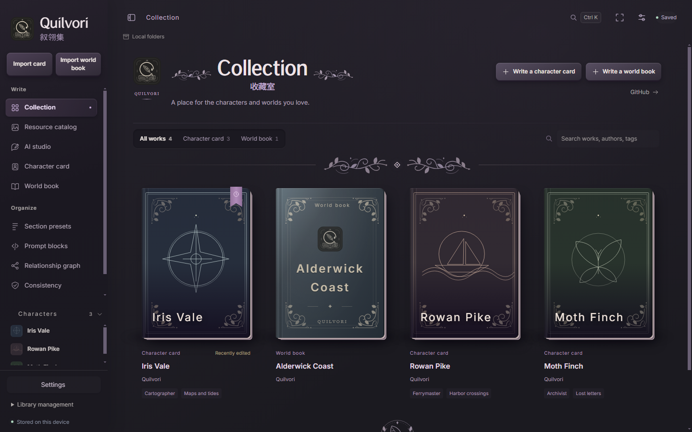
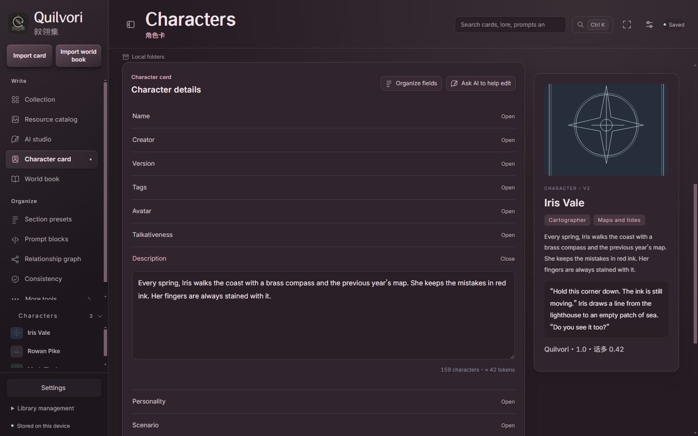
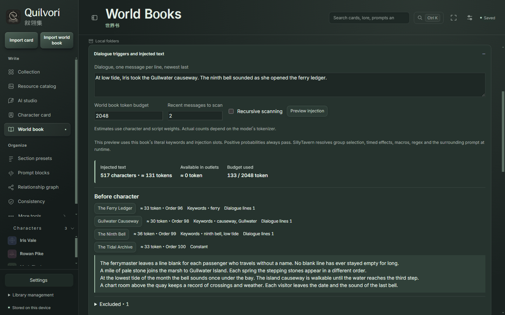

<p align="center"></p>

# Quilvori · 叙翎集

A local collection room and writing workspace for SillyTavern characters and worlds.

**English** · [中文](README.zh.md) · [日本語](README.ja.md) · [Русский](README.ru.md) · [한국어](README.ko.md) · [ไทย](README.th.md)

Quilvori prepares material for SillyTavern. Edit character cards and world books, work with a model you configure, and export the results to SillyTavern. Manual editing, importing, local checks, and backups work independently; AI features require a separate model service.

## See the workbench

The collection, character editor and world-book trigger preview below use a fictional sample library.

<a href="docs/screenshots/collection.png"></a>

<table>
  <tr>
    <td width="50%"><a href="docs/screenshots/character-editor.png"></a></td>
    <td width="50%"><a href="docs/screenshots/world-book-trigger.png"></a></td>
  </tr>
  <tr>
    <td align="center">Character editor</td>
    <td align="center">World-book trigger preview</td>
  </tr>
</table>

## What you can do

- Browse your collection as a portrait and book-cover gallery, with a distinct color palette for each workspace.
- Discover public-source cards, world books, and wallpapers with creator credit and links to the original posts.
- Edit descriptions, personality, scenarios, greetings, example dialogue, and role instructions with a live preview.
- Move mixed character notes into appropriate fields while retaining the original wording and existing destination content.
- Name untitled world entries, classify them, and suggest precise primary keywords without rewriting their bodies.
- Ask AI to edit selected fields, entries, or a text selection; compare the result before applying it, with undo support.
- Adopt ideas, discuss choices, and continue revising the current draft instead of starting over.
- Review facts, characterization, and timelines with source quotations and readable addresses.
- Work with prompts, regex, quick replies, relationship graphs, timelines, and HTML memory.

## Collection gallery and page colors

Use the pin beside a cover’s title to keep a card or world book at the front of the shelf. Unpinning restores its usual position. Pins travel with library backups and stay local when you export to SillyTavern.

The **Collection** home page displays large character portraits and decorative world-book covers, with search, type filters, original-text previews, and quiet **Write a character card** / **Write a world book** actions. Missing portraits use a title cover; the gallery does not generate replacement artwork or change the stored character image.

Pages share typography and controls but use different muted palettes: mist purple for the collection, blue-violet for AI creation, rose gray for characters, sage for world books, champagne for writing tools, slate blue for structural tools, warm brown for reading, plum for narrative planning, smoky pink for assets and resources, and graphite for utilities. The collection adds bookplate scrollwork, corner ornaments, and a colophon seal.

In **Settings → Appearance & language**, use **Use colors by workspace** to follow these palettes, or adjust the colors for a custom theme. Saved custom colors remain available. Sarasa UI fonts, a quill cursor, text size, spacing, and reduced-motion support complete the shared interface.

Fresh profiles start in **English**. A saved, supported language choice is preserved when you update. Chinese, English, Japanese, Russian, Korean, and Thai are available; switching the interface language never translates your authored cards, world books, or source attribution.

### SillyTavern themes

Open **Theme workshop** to import a JSON file or paste a Discord post or attachment link. The catalog credits Selenis for *Lavender Blossoms*, Dascard for *Inkflow Radiance (PC)* and GrizzyBurr for *Solarized Light*. Use the original post to obtain the preset if a local copy is unavailable. The preview uses sample messages. Edit colors and opacity, select a local wallpaper, then save a copy or export native ST JSON. The file retains its source CSS and attribution.

In the desktop workshop, enter your SillyTavern installation, data folder or user directory and connect. Choose the intended profile if several are listed. You can read and switch its existing themes, or install an edited copy. Refresh an open SillyTavern tab to see the change. Original custom CSS is opt-in when applying to ST. Wallpapers and the optional Info Board are separate resources.

## Quick start

Download the repository, or clone it:

```bash
git clone https://github.com/ShangguanQian/Quilvori.git
cd Quilvori
```

### Web app

Requires Python 3 and a modern browser. The web app needs no npm dependencies or build step.

```bash
python3 -m http.server 8765 --bind 127.0.0.1
```

On Windows, you can use:

```powershell
py -m http.server 8765 --bind 127.0.0.1
```

Open [http://127.0.0.1:8765/](http://127.0.0.1:8765/) and keep the server running. You may use another port if needed, but each port has a separate browser library.

Opening `index.html` directly also works in browsers that allow the required file-page storage and API requests. Use the local HTTP server if those features are restricted. Export a full backup before leaving a session that cannot save.

### Desktop app

Starting with 0.2, the Windows x64 download is a single portable `.exe`. Double-click it to launch. On macOS, choose the `arm64` disk image for Apple silicon or `x64` for Intel. Open the `.dmg`, drag **Quilvori** into **Applications** and launch it from there. Both editions include Electron. [Download a published version](https://github.com/ShangguanQian/Quilvori/releases)

Each desktop download has a matching `.sha256` file. Builds without a publisher certificate use an ad-hoc signature on macOS and may need first-launch approval. [Apple’s guidance for downloads](https://support.apple.com/en-us/102445)

#### Run the desktop app from source

From the repository root, use Node.js 22.12 or newer and npm.

```bash
npm ci
npm start
```

On Windows, after installing dependencies, you can also double-click [Start-Quilvori.cmd](Start-Quilvori.cmd). It locates the project relative to itself, so it also works when invoked from another working directory. It closes the console after the Electron process is successfully spawned and keeps errors visible when startup fails.

`npm start` uses [scripts/start.mjs](scripts/start.mjs) and stays attached to the terminal; Ctrl+C stops that launched process. Both entry points require Node.js 22.12 or newer and the project's installed Electron. Missing dependencies produce a clear `npm ci` remedy; the launcher does not download packages automatically or fall back to a global Electron. Repeated launches restore the existing desktop window.

Electron opens the same interface and can read cards and books from folders you select.

## Your first session

1. A fresh library loads the Tingyu House demo. Try editing, checking, and exporting; the unnamed traveler is an intentionally incomplete draft.
2. Import character-card JSON/PNG or world-book JSON from the sidebar, or drop files onto the relevant page.
3. Use **Organize fields** on a character or **Organize entries with AI** on a world book to sort existing material.
4. For rewriting, open **AI creation → Edit existing**, select a precise scope, and describe the change.
5. Review suggestions, apply what you want, export to SillyTavern, and keep a full-library backup.

Loading the demo and clearing the library require confirmation. Loading the demo replaces the current library, so back up your own work first.

## Connect an AI model

Open **Settings → Model connection**:

1. Enter your provider's API base URL, such as `https://api.openai.com/v1`, rather than a complete request endpoint.
2. Enter your API key, choose a protocol, and connect.
3. Select a model from the provider list or enter a model ID. The settings display the context window and reasoning levels when the provider supplies them. You can enter a known context length manually.
4. Save separate named profiles for writing and review. Switch profiles in the AI creation workspace.
5. Optionally select reasoning effort. The default sends no extra reasoning parameter; supported levels depend on the service and model.

Both OpenAI-compatible **Responses** and **Chat Completions** are supported. Automatic mode tries Responses first and switches when the endpoint is unsupported. Choose Chat Completions explicitly for services that only support it. Authentication failures and invalid responses are reported as errors.

Higher reasoning effort usually takes longer. If a level is unsupported, select the model default or a supported level. Availability, output quality, and fees depend on your model provider.

Each model profile has an idle timeout of 1–60 minutes, with a default of 5 minutes. Each incoming chunk starts a new interval. The task record distinguishes waiting for the first data from a stream that has stalled.

Manual work can stay offline. When you request AI generation, organization, discussion, or review, the selected source text, references, instructions, and relevant conversation are sent to your configured endpoint. Desktop model keys use operating-system encryption (Windows user protection or macOS Keychain). The web edition encrypts keys with a non-extractable Web Crypto key held in this browser’s IndexedDB. Migration verifies that every saved key can be decrypted before replacing the old settings. Card exports and library backups omit model credentials.

## AI workflows

### Edit existing material

Choose a character or world book, then select its editable fields or entries. A text selection can limit an edit to one passage. Other material is reference context, and suggestions show a before/after comparison.

Omitted fields retain their values. Clearing existing content requires explicit permission. Clarification requests, incomplete output, out-of-scope fields, or source changes made during a request do not silently overwrite your draft. Applied edits can be undone; undo refuses to overwrite subsequent manual changes.

### Create and continue a draft

Describe your goal and press **Start writing**. Choose modules if needed. **Questions** and **Ideas** are optional. Only answered questions and checked ideas enter the writing request.

The creation conversation uses the current draft and your selected ideas. You can visit other pages in the same window while generation, discussion, organization or review runs. Return to the work that started the task to see its progress or result. Character and world-book previews support revising selected fields or entries.

New character cards and world books are saved locally as drafts. Find **AI drafts awaiting review** in the Collection or the corresponding editor, review the draft, and apply it. **Open in collection** takes you to the saved work. Apply a generated character before applying a group, script or relationship graph that references it.

When a provider returns a character and a world book together, Quilvori checks the selected works separately. A valid work appears in the draft shelf even if the other needs attention. By default, this device keeps the last 24 card and world-book responses with output. Open **AI studio → Task log and model output** to recover drafts from a response, or paste a response copied from an older version. Recovery runs locally. Discussion accepts ordinary text, and you can revise the draft directly from the latest reply.

### Review logic and characterization

Local rules and AI reviews appear separately. Reports explain the conclusion, why it may be a problem, and a possible next step. Quotations include character-field addresses or **world book → entry → field → line** locations.

Open a source quotation and return to the report afterward. Reports preserve their source addresses and are marked outdated when relevant text changes. Optional blank fields appear as notes. A conflict requires two distinct passages that can be located in the source. A single quotation or overlapping excerpts appear under **Needs confirmation** in the report and its JSON export. Review itself does not rewrite the draft.

Large books can be reviewed in selected batches, with the scope stated in the report. Task records separate status, reasoning returned by the service, and results; missing reasoning is reported explicitly.

## Organize character fields

Click **Organize fields** in the character editor. Add optional preferences and request a preview.

- The organizer considers description, personality, scenario, first greeting, dialogue examples, system prompt, post-history instructions, and creator notes.
- Each suggestion names its source, destination, and reason, with a before/after field comparison.
- Original fragments are moved verbatim and appended to existing destination content. Unselected or uncertain material remains where it was.
- Removing from the source and adding to the destination apply together. Unmatched quotations, overlapping fragments, and changed source text block application.

This workflow organizes existing material; it does not invent missing history. Review the proposed classifications, and leave optional fields blank when appropriate.

## Organize world-book metadata

Use **Organize entries with AI** for the current entry, untitled entries or entries missing trigger words, or the entire current book. **Organize this entry** is also available in the entry editor.

- Categories cover characters, relationships, locations, factions, rules, history, items, plot, and other material. The directory can group entries by content category.
- By default, only untitled/new entries receive names. Renaming an existing title requires a separate option.
- Suggested primary keywords come from the entry body or original title. Applying them appends new words and preserves all existing primary and secondary keys.
- Always-on entries may have no keywords. Changing activation mode requires enabling the separate permission option.
- Switching to keyword activation requires at least one primary key. Body text, enabled state, selective conditions, injection position, depth, and order are not reset by organization.

Every suggestion includes evidence and a reason. Apply selected entries and undo as needed. Categories are exported through the `realmweave_category` extension field in world books and embedded character books; they do not replace SillyTavern activation settings.

## Context tools and search

Character fields and world-book entries show character counts and estimated tokens. The world-book editor shows enabled always-on costs, keyword conflicts and possible entry links. Paste one message per line, set a scan depth and token budget, then inspect the ordered text for each injection position. Counts use a local estimate. Model tokenizers, macros, probability and other SillyTavern runtime settings can change the result.

The export preview lets you omit disabled entries, compact whitespace, remove repeated paragraphs, split long entries or select a core edition. These choices apply to the exported copy. In either search box, find text across cards, entries, prompts and regex scripts. **Ctrl+K** or **Cmd+K** also opens pages and offers organize and export actions for named works.

## Pages and tools

| Page | Purpose |
| --- | --- |
| Collection | Portrait and book-cover gallery, search, previews, and new-work actions. |
| Resource catalog | Curated original-source cards, world books, and wallpapers with attribution and import previews. |
| Character cards | Edit SillyTavern card fields and import/export JSON or card PNG. |
| World books | Edit entries and injection settings, test triggers, group by position or category. |
| AI creation | Scoped edits, new drafts, conversation, review, and application previews. |
| Writing sections | Combine style, viewpoint, relationships, boundaries, and output format. |
| Prompt assembly | Order and enable prompt blocks for comparison with a SillyTavern preset. |
| Group cast | Select characters and set scenarios, talkativeness, and speaking behavior. |
| Chat reader | Read JSONL or message arrays; search, bookmark, and copy. |
| Assets | Manage avatars, expressions, and backgrounds saved with the library. |
| Regex scripts | Enter original text, the expected result and an optional example to leave unchanged. Test a local template or ask AI to propose a rule for those examples. Export the finished script to the SillyTavern Regex extension. |
| Quick replies | Create a general set or choose a reference character and world book. Ask for relevant entries or select individual entries. Review the buttons and messages before exporting Quick Reply v2. |
| Story journal | Plan a scene or link a note or story beat to an imported chat message. Open the source from the journal, or open its notes from the message in the chat reader. |
| Relationship graph | Edit nodes and links and export a world book. |
| Consistency checks | Read local/AI reports and navigate to their sources. |
| Group script | Arrange character lines, narration, and triggers. |
| HTML memory | Create HTML memory for JS-Slash-Runner. |
| Full-library backup | Export the local library; restore by replacing or merging. |
| Guide | Instructions and destinations for exported files. |

Appearance, language, writing preferences, and models live in Settings. The Chinese interface uses bundled Sarasa fonts. Six interface languages are available; changing the interface does not translate existing authored text.

## Import, export, and SillyTavern

When a prompt preset contains several execution orders, choose the `character_id` you want to edit. Export keeps that scope’s native identifiers, order and switches. Definitions outside the selected order stay available in the editor and are inactive until enabled.

| Material | Format and destination |
| --- | --- |
| Character card | JSON or PNG with `chara`/`ccv3` data. Use SillyTavern's character import; optionally embed a world book on export. |
| World book | World Info JSON, including support for character-book `entries` arrays. Import in World Info. |
| Regex | JSON array, imported through the Regex extension. |
| Quick replies | Quick Reply v2 JSON, imported through that extension. |
| Expressions | Bundles install sprites at `characters/<character>/<expression>.<ext>`. The standalone expression-folder export uses an `expressions` subfolder. |
| Prompts | Block configuration for reference, not a complete API preset that replaces model or temperature settings. |
| Group cast | A roster for creating a group after importing its characters, not a universal group import file. |
| Chat reader, story journal and scripts | Quilvori reading and planning files. Configure SillyTavern’s Author’s Note in its chat to inject instructions into the model context. |
| HTML memory | Import as an HTML script in JS-Slash-Runner. |
| Full-library backup | Quilvori library JSON, not a full SillyTavern server backup. |

### Export a character bundle

In the character editor, select a companion world book and expand the SillyTavern bundle. Choose expressions and Quick Reply sets, then review the paths. The ZIP contains a character PNG with the embedded book, the separate World Info JSON, and your selected assets. Extract the ZIP into a SillyTavern user folder. On desktop, **Install into a SillyTavern user folder** writes the same layout and stops if a target filename already exists.

### Read local folders

Expand **Local folders → Scan a SillyTavern user folder** and choose a profile such as `data/default-user`. Review the counts for `characters/*.png|json`, `worlds/*.json` and `chats/<character>/*.jsonl` before importing. The desktop app also supports separate card and world-book folders.

Duplicates are skipped. Changing only the PNG portrait also creates a separate version and preserves local edits. Scanning the same version again reuses its card. A bad file does not stop the other imports, and failures appear in the details. Large avatars are reduced. When storage is full, text is saved first. Scan again after freeing space to add the missing portraits. Reading folders does not modify source cards or books. When a desktop expression export would replace files, review the listed filenames before confirming. A failed batch restores the original files. If another program prevents recovery, Quilvori shows the folder containing the backups and their manifest.

### Import character cards and world books from links

Choose **Import from link** on the world-book page and read a public HTTPS URL. Supported sources include world-book JSON, specific GitHub file pages, and JSON/PNG character cards with embedded books. Card sources contribute only their world book.

The character-card page also offers **Import from link** for card JSON and PNG files containing card data. Preview the avatar, field text, and alternate greetings, then choose whether to include the embedded world book. Optional blank fields are retained, and PNG avatars are resized for storage. The included book is selected in the export control. You can import only the card first and later read the same URL to add its book while keeping your edited text.

Preview the title, entries, always-on count, and untitled count; search the source text and edit the local name before importing. Duplicates open the existing version with local edits preserved. Updated content from the same source is saved as a separate book. The import notification offers undo, which refuses to discard later edits.

Cards also skip duplicates and save source updates separately. Undo can remove the card, avatar, and book added by that import; later edits or references prevent undo from discarding subsequent work.

For Discord, copy the JSON/PNG attachment download URL. Resolving a post or channel requires separate server authorization and a bot integration. Attachment links can expire; copy a fresh one from the original post. No Discord account token or AI call is needed for attachment imports.

Files are limited to 12 MB, with cancellation and timeout handling. Desktop reads public HTTPS files and uses the system proxy for GitHub and Discord CDN attachments when available; web imports depend on the source CORS configuration. If blocked, use desktop or download and import the file. Stored source records omit query parameters, so temporary download signatures are not saved in your library.

## Resource directory and creator attribution

**Resource catalog** is a curated directory of character cards, world books, and wallpapers. Browse creator-supplied preview images, filter by type, search titles/authors/tags, open a full image, and follow related works. Each entry names its author, links to the original post, and displays the recorded usage information. It is a source directory, not a mirror of your private library or an automatic Discord search service.

Use **Open original post** to read the author's instructions and obtain the current attachment link. Discord may require your account and server membership. The directory cannot bypass those requirements or resolve arbitrary post links into files. Expiring attachment URLs must be copied again from the original post.

- **Cards and world books:** the directory opens the existing link-import preview. When a work has no confirmed redistribution permission, the catalog has no bundled downloadable file: paste an attachment URL you obtained from the original source. Card PNG/JSON and world-book JSON downloads are limited to 12 MB. The browser is subject to source-site CORS rules; desktop imports may work where browser imports do not.
- **Wallpapers:** choose an original PNG, JPEG, or WebP file or paste its HTTPS attachment URL. SVG, HTML, and UI theme files are not accepted. The input is limited to 12 MB, 8192 pixels per edge, and 40 megapixels. The saved local copy is reduced to at most 1600 pixels on its longest edge and 500 KB; this is not an archival 4K download. Obtain full-resolution originals from the author.
- **Before saving:** review the preview and source information. Imported cards, books, and wallpapers retain sanitized author and original-post metadata. The local editors show this information in collapsed source details; character/world-book exports preserve it in the `quilvori_source` extension. Temporary download signatures and account tokens are not retained in public attribution.

An “unknown” usage status is not permission to redistribute. Public visibility does not place a work under this repository's GPLv3 license. Follow the original creator's terms and support them in the original post's comments if you enjoy their work; Quilvori does not post messages or comments on your behalf.

## Storage, backups, and updates

Your library and revision history use IndexedDB in the current browser or desktop profile. On upgrade, Quilvori migrates the previous localStorage library and archives the original bytes in the same transaction. **Full-library backup → Download pre-migration library** retrieves that copy. Browser profiles, addresses and ports can have separate libraries. Use the same entry point each time and move your current library with backup export and restore.

IndexedDB schema v6 stores works as separate records. Editing a card field writes that card and its revision metadata. Editing an image name or a chat bookmark leaves the image data and message body in separate records. Imports and whole-library replacements still validate the complete candidate library.

Opening a v5 library upgrades its database to v6. To keep using v0.2.0 as well, close the app before the upgrade and keep a separate copy of the complete v5 user profile for that version.

The full-library JSON (`backupVersion: 2`) includes your works, pending card and world-book drafts, revision snapshots (including removed works), per-work retention rules, and saved model responses with their original output. Export reads one consistent IndexedDB transaction. Replace restores this state together. Merge keeps both sides, deduplicates matching records and gives conflicting drafts or responses separate IDs. Snapshot retention expands to keep the merged history. Merging more than 24 responses preserves them and raises the subsequent rolling archive window to that count. Older library-only files preserve the working records already on the device. Model connection profiles, API keys and local directory selections stay on the device. Treat the backup as private writing material.

In **Version history → Manage snapshots for this work**, review the number of snapshots and their estimated content size. Preview the dated revisions selected for removal before confirming a retention limit or clearing the work’s history. A blank limit keeps all snapshots. A saved limit also applies to future manual and automatic snapshots. Size estimates use UTF-8 JSON bytes and exclude IndexedDB overhead. **Full-library backup → Library snapshot storage** shows totals and lets you review snapshots left by removed works.

The storage phase of `npm run test:ui` compares five single-field saves with synthetic 64 KiB and 16 MiB image/chat payloads. It reports median input handling and save times, and measures snapshot growth after five 8 KiB additions to one work. Results depend on the device and describe these test libraries.

Importing an individual chat reading copy restores its messages, bookmarks and original SillyTavern header. When deleting a character, review its references and choose whether to unlink them, replace the character or keep the speaker’s name on script lines. Character cards, world books, image assets, chats, groups, regex scripts and quick-reply sets offer **Undo deletion** in the confirmation toast after removal.

Before merging a backup, expand a conflicting field to compare the changed paragraphs. Choose **Keep current** (the default), **Use backup** or **Keep both as separate copies**. Several fields marked for a separate copy create one new work with its own ID. Divergent chat histories keep their respective bookmarks. Alternate values for standalone settings or HTML memory can be opened on the Backup page. Cancelling the preview keeps the current library.

Open **Version history** in either editor to save a named snapshot, compare fields and world-book entries, or restore one work. Applying AI edits also saves its previous version.

The Windows desktop app retains `%APPDATA%\nijan` for its profile and `folders.json`. This internal directory name preserves compatibility; the displayed project name is Quilvori / 叙翎集.

Backups contain your cards, books, images, and other authored material. Keep them somewhere you control, and export before changing computers, browsers, ports, or code versions. Ignore rules cover common local data folders; still inspect staged files before committing so personal work and keys stay out of source control.

With no unresolved local code changes, update using:

```bash
git pull --ff-only
npm ci
```

Restart the desktop app or refresh the web page. Web-only users do not need `npm ci`. Save and resolve local code edits before updating.

## Troubleshooting

**The desktop app does not start.** Check `node --version` (22 or newer), then run `npm ci` from the repository root. Launch with `npm start`, or use `Start-Quilvori.cmd` on Windows. Installing Electron globally is unnecessary. A successful process spawn is not proof that a later application error cannot occur; if the window closes unexpectedly, use `npm start` to keep the terminal output available.

**The character list is empty.** Check that you opened the same browser, port, or desktop app. Import files in the web app, or read configured folders in Electron. Selecting a folder does not share the library with another browser.

**A PNG will not import.** A normal image is not a card. It must contain valid character data; alternatively, use character JSON exported by SillyTavern.

**Connection or generation fails.** Check the base URL, key, model, and protocol. Choose Chat Completions for services that require it. Browser cross-origin access depends on the provider. If output is truncated or context is too large, reduce the selected scope and work in batches.

**Reasoning effort is rejected.** Use the model default or a supported level; models do not all accept the same parameters.

**Storage is full.** Export a backup before reducing large images. Do not clear browser data unless you have verified that your backup can restore the library.

**Why is there no automatic write-back to SillyTavern?** Quilvori's local library and SillyTavern files are separate. Export your finished material and import it through the corresponding SillyTavern interface.

## Tests and source layout

```bash
npm run validate
```

`npm run check` checks JavaScript syntax; `npm test` runs the behavior tests. CI runs these checks on Node.js 22 and 24 on Ubuntu and Windows.

Tests use sample data and mock interfaces rather than paid model calls. They cover format round trips, folder deduplication, lossless moves, metadata organization, editable scope, optional blanks, stale previews, apply/undo, evidence, transport protocols, reasoning parameters, locales, page palettes, attribution sanitization, resource catalogs, and bounded wallpaper imports.

`js/` contains the interface, library model, and AI workflows; `electron/` supplies the desktop file bridge; `css/` contains styles; `test/` contains automated checks. The web app uses regular scripts without a bundler.

## Contributing

Read [CONTRIBUTING.md](CONTRIBUTING.md) for setup, validation, translation keys, data-preservation expectations, and resource attribution. Commit messages and pull-request titles/descriptions are written in English.

## License

Quilvori is licensed under the **GNU General Public License, version 3 only** — SPDX identifier **GPL-3.0-only**. Read the complete [LICENSE](LICENSE), the scope and history in [LICENSING.md](LICENSING.md), and the attribution and third-party notices in [NOTICE](NOTICE).

You may use, modify, and redistribute the application, including commercially. When you distribute covered modified versions, the covered derivative work must remain under GPLv3; retain the required notices and provide the Corresponding Source as required by the license. Private modifications do not create a general obligation to post source code publicly. No additional noncommercial restriction is imposed.

Earlier revisions distributed under MIT retain their original grants; this license change does not revoke those rights. The current release uses GPL-3.0-only, not an “or later” option. See [licensing history](LICENSING.md) for the distinction.

Third-party fonts, artwork, and referenced resource works keep their own terms. Bundled Sarasa fonts have a separate [font license](fonts/OFL-Sarasa.txt). Resource preview images are **not licensed under the application's GPLv3 license**, and no general external redistribution license was found in the reviewed author posts. See [resource preview attribution](img/resources/ATTRIBUTION.md) for creator credits, original posts, and recorded status. The project license does not grant additional rights to redistribute those works.
