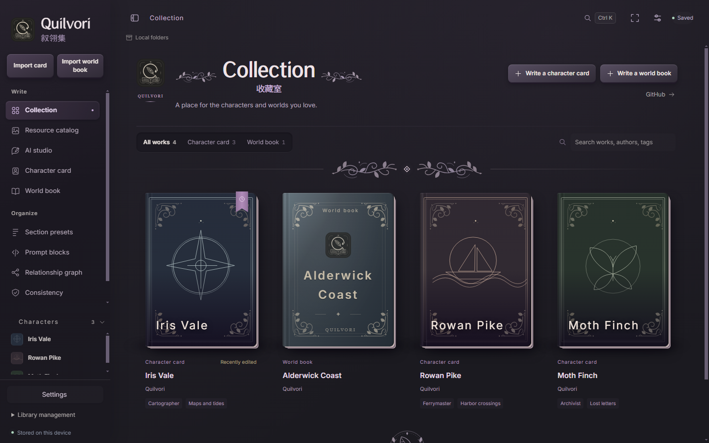

<p align="center"></p>

# Quilvori · 叙翎集

Локальный рабочий стол для персонажей, миров и заметок, которые пора привести в порядок. ✍️

[English](README.md) · [中文](README.zh.md) · [日本語](README.ja.md) · **Русский** · [한국어](README.ko.md) · [ไทย](README.th.md)

Quilvori помогает готовить материалы для SillyTavern: редактировать карточки и книги мира, дорабатывать их с выбранной моделью и экспортировать результат. Ручное редактирование, импорт, локальные проверки и резервные копии работают самостоятельно. Для функций ИИ нужен отдельно настроенный сервис моделей.

## Снимки экрана

Коллекция, редактор персонажей и проверка активации книги мира показаны на примере вымышленной библиотеки.

<a href="docs/screenshots/collection.png"></a>

<table>
  <tr>
    <td width="50%"><a href="docs/screenshots/character-editor.png"></a></td>
    <td width="50%"><a href="docs/screenshots/world-book-trigger.png"></a></td>
  </tr>
  <tr>
    <td align="center">Редактор персонажей</td>
    <td align="center">Проверка активации записей</td>
  </tr>
</table>

## Коллекция, палитры страниц и каталог ресурсов

Главная страница показывает крупные портреты персонажей и обложки книг мира. Есть поиск, фильтры, предпросмотр исходного текста и действия для создания карточки или книги. Если портрета нет, используется текстовая обложка, а не сгенерированная замена авторскому изображению. Оформление дополняют книжные орнаменты и экслибрис.

У разделов свои приглушённые палитры: сиреневая у коллекции, сине-фиолетовая у ИИ, розово-серая у карточек, шалфейная у книг, шампань у письменных инструментов, сланцево-синяя у структурных, тёплая коричневая у чтения, сливовая у сюжетов, дымчато-розовая у изображений и ресурсов, графитовая у служебных страниц. В настройках внешнего вида можно переключаться между палитрами разделов и собственными цветами. Сохранённые пользовательские цвета остаются доступными.

Новый профиль запускается на английском. При обновлении сохраняется ранее выбранный поддерживаемый язык. Доступны китайский, английский, японский, русский, корейский и тайский; смена интерфейса не переводит текст произведений и имена авторов.

Каталог ресурсов содержит авторские изображения для предпросмотра, имена авторов, описания, ссылки на оригинальные публикации и условия использования. Он охватывает карточки, книги мира и обои, но не копирует личную библиотеку и не ищет автоматически по произвольным сообщениям Discord. Для исходного поста могут требоваться ваша учётная запись и доступ к серверу. Поддержать автора можно комментарием под оригиналом; приложение ничего не публикует от вашего имени.

Если разрешение на распространение не подтверждено, файл произведения не включается в каталог: скопируйте ссылку на вложение из исходного поста. Карточки PNG/JSON и книги JSON импортируются после предпросмотра; предел загрузки — 12 МБ. В браузере действуют ограничения CORS, а просроченные ссылки Discord нужно получить заново. Обои принимаются только в PNG/JPEG/WebP: до 12 МБ, 8192 пикселей по каждой стороне и 40 мегапикселей. Локальная копия уменьшается до 1600 пикселей по длинной стороне и 500 КБ; полноразмерный оригинал берите у автора. SVG, веб-страницы и файлы тем не импортируются как обои.

Очищенные сведения об авторе и исходном посте сохраняются в раскрываемом блоке редактора и в расширении `quilvori_source` при экспорте карточек/книг. Публичная доступность не означает разрешения на распространение и не распространяет GPLv3-лицензию репозитория на чужие произведения. Перед вкладом в проект прочитайте английское [руководство для участников](CONTRIBUTING.md).

## Возможности

- Редактирование описания, характера, сценария, приветствий, примеров диалогов и инструкций с предпросмотром.
- Распределение смешанных заметок по полям с сохранением исходного текста и уже заполненных полей.
- Названия, категории и точные ключевые слова для записей книги мира без переписывания основного текста.
- Изменение только выбранных полей, записей или фрагмента; сравнение до применения и отмена.
- Обсуждение идей и доработка текущего черновика с учётом принятых направлений.
- Проверка фактов, характера и хронологии с цитатами и понятными адресами источников.
- Работа с промптами, регулярными выражениями, быстрыми ответами, отношениями, событиями и HTML-памятью.

### Мастерская тем SillyTavern

В мастерской тем можно выбрать JSON или вставить ссылку на публикацию Discord либо вложение. В каталоге указаны авторы и исходные публикации для Lavender Blossoms (Selenis), Inkflow Radiance для ПК (Dascard) и Solarized Light (GrizzyBurr). Если локальной копии нет, возьмите файл из публикации автора. Отрегулируйте цвета, прозрачность и размытие, подберите обои и экспортируйте JSON для ST с исходным CSS и указанием авторства.

В настольной версии укажите папку установки SillyTavern, data или каталог пользователя. Выберите нужный профиль, чтобы открыть или переключить существующую тему либо установить отредактированную копию. Обновите открытую вкладку SillyTavern. Авторский CSS включается по вашему выбору. Обои и Info Board загружаются отдельно.

## Быстрый запуск

Скачайте репозиторий или клонируйте его:

```bash
git clone https://github.com/ShangguanQian/Quilvori.git
cd Quilvori
```

### Веб-версия

Нужны Python 3 и современный браузер. Установка npm-зависимостей и сборка веб-версии не требуются.

```bash
python3 -m http.server 8765 --bind 127.0.0.1
```

В Windows можно использовать:

```powershell
py -m http.server 8765 --bind 127.0.0.1
```

Откройте [http://127.0.0.1:8765/](http://127.0.0.1:8765/) и оставьте сервер работающим. При необходимости можно сменить порт, но библиотека браузера на другом порту будет отдельной.

Также можно открыть `index.html` напрямую. Если браузер ограничивает хранилище или API-запросы для файловых страниц, используйте локальный HTTP-сервер. Перед выходом из сеанса, в котором сохранение недоступно, экспортируйте полную копию библиотеки.

### Настольная версия

Установите Node.js 22 / 24 и npm. В корне репозитория выполните:

```bash
npm ci
npm start
```

В Windows после установки зависимостей можно дважды щёлкнуть [Start-Quilvori.cmd](Start-Quilvori.cmd) в репозитории. Скрипт определяет проект по собственному расположению и работает при запуске из другой папки. После успешного запуска процесса консоль закрывается; при ошибке сообщение остаётся на экране. Нужен Node.js 22 или новее. Если зависимости отсутствуют, скрипт предложит выполнить `npm ci` в папке проекта; он не скачивает их автоматически и не использует глобальный Electron.

Electron откроет тот же интерфейс; Python-сервер для этого не нужен. Настольная версия дополнительно читает существующие карточки и книги из выбранных папок. Сейчас приложение запускается из исходников; готового установщика Windows в репозитории нет.

## Первое знакомство

1. В новой библиотеке загружается пример «听雨楼». На нём можно попробовать правки, проверки и экспорт. «未名客» специально оставлен незавершённым.
2. Импортируйте JSON/PNG карточки или JSON книги мира через боковую панель либо перетащите файлы на нужную страницу.
3. Откройте распределение карточки по полям или упорядочение книги с ИИ, чтобы разобрать исходные материалы.
4. Для переписывания перейдите в создание с ИИ, выберите редактирование существующего и задайте точную область.
5. Проверьте предложения, примените нужные, экспортируйте в SillyTavern и сохраните резервную копию.

Загрузка примера и очистка библиотеки требуют подтверждения. Повторная загрузка примера заменит текущую библиотеку — сначала сохраните свои материалы.

## Подключение модели

Откройте настройки подключения модели:

1. Укажите базовый URL API, например `https://api.openai.com/v1`, а не полный адрес конкретного запроса.
2. Введите свой API-ключ, выберите протокол и подключитесь.
3. Выберите модель из списка, который вернул сервис. Короткое тестовое сообщение поможет проверить соединение.
4. При необходимости задайте уровень рассуждения. По умолчанию дополнительный параметр не отправляется; доступные уровни зависят от модели и сервиса.

Поддерживаются OpenAI-совместимые **Responses** и **Chat Completions**. Автоматический режим сначала пробует Responses и переключается, если конечная точка не поддерживается. Если сервис работает только с Chat Completions, выберите его явно. Ошибки авторизации и неверные ответы не считаются успешным результатом.

Более высокий уровень рассуждения обычно требует больше времени. Если сервис отвергает уровень, вернитесь к значению по умолчанию или выберите поддерживаемый. Доступность, качество и стоимость определяет ваш поставщик модели.

В каждом профиле модели можно задать время ожидания данных от 1 до 60 минут, по умолчанию 5 минут. С получением очередной порции данных отсчёт начинается заново. В журнале задач видно, истекло ли время ожидания первых данных или передача прервалась позднее.

Ручная работа доступна без сети. При запросе генерации, упорядочения, обсуждения или проверки выбранный текст, справочные материалы, инструкции и относящийся к задаче диалог отправляются на настроенный API. Ключ хранится локально в браузере или приложении и не попадает в экспорт карточек или полную резервную копию библиотеки.

## Работа с ИИ

### Редактирование существующего

Выберите карточку или книгу, затем разрешённые поля либо записи. Можно ограничиться выделенным фрагментом. Остальные материалы используются как контекст; результат показывается в сравнении «до/после».

Пропущенные в ответе поля сохраняют прежние значения. Очистка заполненного поля требует отдельного разрешения. Уточняющий вопрос, оборванный ответ, выход за область правки или изменение исходника во время запроса не приводят к скрытому перезаписыванию. Отмена также проверяет, не появились ли последующие ручные правки.

### Создание и продолжение черновика

Опишите замысел и начните писать. На уточняющие вопросы можно ответить по желанию. При генерации учитываются заполненные ответы и выбранные идеи.

Обсуждение учитывает текущий черновик и принятые идеи. Пока идёт генерация, обсуждение, упорядочивание полей или проверка, можно перейти на другую страницу в том же окне. Вернитесь к исходной работе, чтобы увидеть ход задачи или результат. В предпросмотре можно доработать отдельные поля карточки или записи книги мира.

Новые карточки и книги мира сохраняются на устройстве как черновики. Раздел «Черновики ИИ для просмотра» есть в коллекции и в соответствующем редакторе. Проверьте и примените черновик, затем нажмите «Открыть в коллекции». Если группа, сценарий или граф ссылается на нового персонажа, сначала примените его карточку.

Если модель вернёт карточку и книгу мира вместе, мастерская проверит выбранные произведения отдельно. Исправное произведение попадёт в черновики, даже если другое требует исправления. Последние 24 ответа с текстом для карточек и книг мира сохраняются на этом устройстве. В журнале задач студии ИИ можно восстановить черновик из ответа или вставить текст, скопированный из прежней версии. Восстановление выполняется локально. В обсуждении можно получить ответ обычным текстом и сразу применить его к черновику.

### Проверка логики и образа персонажа

Локальные правила и проверка моделью показаны отдельно. В отчёте есть простой вывод, объяснение и предложение дальнейшего действия. Цитаты сопровождаются адресом поля карточки либо «книга → запись → поле → строка».

Можно открыть источник и вернуться в отчёт. Он хранит адреса исходных цитат и помечается устаревшим после изменения текста. Необязательные пустые поля — замечания, а различия без достаточного основания требуют уточнения. Сама проверка текст не изменяет.

Большие книги можно проверять по выбранным записям; охват явно указан. В журнале задач раздельно хранятся состояние, возвращённые сервисом рассуждения и результат. Отсутствие рассуждений также отмечается.

## Распределение карточки по полям

Откройте упорядочение в редакторе карточки, при желании задайте предпочтения и запросите предпросмотр.

- Обрабатываются описание, характер, сценарий, основное приветствие, примеры диалога, системный промпт, инструкции после истории и заметки автора.
- Для каждого переноса показаны исходное и целевое поля, причина и сравнение.
- Фрагменты переносятся дословно и добавляются к существующему тексту. Невыбранные и неоднозначные сведения остаются на месте.
- Удаление фрагмента из исходного поля и добавление в целевое применяются вместе. Несовпадающие цитаты, пересечения и изменившийся оригинал блокируют применение.

Это обработка имеющегося материала, а не создание недостающей биографии. Проверьте классификацию; необязательные поля могут оставаться пустыми.

## Названия, категории и ключи книги мира

Можно обработать текущую запись, безымянные записи или записи без нужных ключей, либо всю текущую книгу. В редакторе есть и отдельный вход для одной записи.

- Категории: персонажи, отношения, места, организации, правила, история, предметы, сюжет и прочее. Список можно группировать по содержанию.
- По умолчанию названия добавляются лишь безымянным/новым записям. Смена существующего названия включается отдельно.
- Основные ключи берутся из текста или прежнего названия записи. Новые слова добавляются, существующие основные и дополнительные ключи сохраняются.
- Постоянная запись может не иметь ключей. Изменение режима активации допускается только при отдельном разрешении.
- Для перехода к активации по ключам нужен хотя бы один основной ключ. Текст, состояние включения, дополнительные условия, позиция, глубина и порядок не сбрасываются.

Предложения содержат цитату и объяснение. Можно применить выбранные записи и отменить изменения. Категория экспортируется в расширении `realmweave_category` обычной и встроенной книги; настройки активации SillyTavern остаются отдельными.

## Страницы и инструменты

| Страница | Назначение |
| --- | --- |
| Коллекция | Крупные обложки, поиск, фильтры, предпросмотр и создание работ. |
| Ресурсы | Оригинальные публикации, авторы и импорт карточек, книг и обоев с предпросмотром. |
| Карточки | Поля SillyTavern, импорт/экспорт JSON и PNG с данными. |
| Книги мира | Записи, вставка, проверка активации, группировка по позиции или теме. |
| Создание с ИИ | Выборочные правки, новые черновики, диалог, проверка и предпросмотр. |
| Настройки текста | Стиль, точка зрения, отношения, границы и формат. |
| Сборка промпта | Порядок и включение блоков подсказок. |
| Состав группы | Персонажи, сценарий, разговорчивость и способ участия. |
| Чтение чатов | JSONL/массивы сообщений, поиск, закладки и копирование. |
| Ресурсы | Аватары, эмоции и фоны внутри библиотеки. |
| Регулярные выражения | Введите исходный текст, ожидаемый результат и при желании пример, который нужно оставить без изменений. Испытайте локальный шаблон или попросите ИИ составить правило по примерам. Готовый скрипт можно экспортировать для расширения Regex. |
| Быстрые ответы | Создайте универсальный набор или выберите карточку персонажа и книгу мира. Можно подобрать подходящие записи книги по запросу или отметить их вручную. Проверьте кнопки и тексты перед экспортом в Quick Reply v2. |
| Сюжетный дневник | Планируйте сцены или привяжите заметку либо сюжетное событие к реплике из импортированного чата. Из дневника можно перейти к реплике, из чата — открыть связанную запись. |
| Граф отношений | Узлы, связи и экспорт в книгу мира. |
| Проверка согласованности | Локальные/AI-отчёты с переходом к источникам. |
| Сценарий группы | Реплики, повествование и триггеры по порядку. |
| HTML-память | HTML для JS-Slash-Runner. |
| Резервная копия | Полный экспорт; восстановление заменой или слиянием. |
| Руководство | Инструкции и назначение экспортированных файлов. |

В настройках находятся оформление, язык, предпочтения письма и модели. Для китайского интерфейса включены локальные шрифты Sarasa. Поддерживаются шесть языков; смена языка не переводит написанный вами текст.

## Импорт и экспорт в SillyTavern

| Материал | Формат и назначение |
| --- | --- |
| Карточка | JSON или PNG с `chara`/`ccv3`; импорт через список персонажей. При экспорте можно вложить книгу. |
| Книга мира | World Info JSON или массив `entries` книги персонажа; импорт через World Info. |
| Regex | JSON-массив через расширение Regex. |
| Быстрые ответы | JSON Quick Reply v2 через соответствующее расширение. |
| Эмоции | Изображения в папке персонажа `expressions`; книга хранит название набора, а не картинки. |
| Промпты | Блоки для сверки с пресетом, а не полный API-пресет с моделью и температурой. |
| Группа | Список для создания группы после импорта персонажей, а не универсальный групповой файл. |
| Чаты, сюжетный дневник и сценарии | Файлы Quilvori для чтения и планирования. Чтобы передать модели указание через авторскую заметку, настройте её в нужном чате SillyTavern. |
| HTML-память | HTML-скрипт для JS-Slash-Runner. |
| Резервная копия | JSON библиотеки Quilvori, не копия всего сервера SillyTavern. |

### Чтение локальных папок

В настольной версии откройте локальные папки, выберите каталоги карточек и книг и прочитайте существующие файлы. Читаются JSON/PNG карточек и JSON книг непосредственно в выбранном каталоге, включая книги внутри карточек.

Дубликаты пропускаются; изменившийся источник добавляется новой версией без затирания локальных правок. Ошибка одного файла не останавливает остальные и показывается в подробностях. Крупные аватары уменьшаются; при нехватке места новые изображения могут быть пропущены ради сохранения текста. Чтение не меняет исходные карточки и книги. Явный экспорт эмоций из приложения записывает файлы в выбранное место.

### Импорт карточек и книг по ссылке

На странице книг выберите импорт по ссылке и вставьте публичный HTTPS-адрес. Поддерживаются JSON книг, страницы конкретных файлов GitHub и JSON/PNG карточки со встроенной книгой. Из карточки извлекается только книга.

На странице карточек также доступен импорт по ссылке: JSON карточки или PNG со встроенными данными. Сначала просмотрите аватар, текст полей и альтернативные приветствия, затем выберите, добавлять ли встроенную книгу мира. Необязательные пустые поля сохраняются, PNG-аватар уменьшается для хранения. Добавленная книга выбирается в поле экспорта. Можно сначала добавить только карточку, а позже открыть ту же ссылку и добавить книгу, сохранив отредактированный текст.

До сохранения просмотрите название, записи, количество постоянных и безымянных записей. Можно искать по тексту и менять локальное название. Повторный импорт открывает имеющуюся версию с вашими правками, а обновлённый источник сохраняется отдельной книгой. Отмена в уведомлении не удаляет последующие изменения.

Для карточек также пропускаются дубликаты, а обновления сохраняются отдельно. Отмена удаляет добавленные этим импортом карточку, аватар и книгу; последующие правки или ссылки из других материалов блокируют отмену и сохраняют вашу работу.

В Discord копируйте ссылку на скачивание JSON/PNG-вложения. Для чтения сообщений и каналов нужны отдельное разрешение сервера и интеграция с ботом. Если ссылка истекла, скопируйте её заново из исходного сообщения. Импорт вложений не требует пользовательского Discord Token и не вызывает ИИ.

Лимит — 12 МБ; поддерживаются остановка и тайм-аут. Приложение скачивает публичные HTTPS-файлы; для GitHub и вложений Discord CDN при наличии используется системный прокси. Веб-версия зависит от CORS источника. При ограничении используйте приложение или импорт скачанного файла. В сохранённом адресе источника нет параметров запроса и временных подписей скачивания.

## Хранилище, копии и обновления

Библиотека хранится в `IndexedDB` текущего браузера или приложения и не отправляется в GitHub автоматически. Разные профили, порты, `localhost` и `127.0.0.1`, файловая страница и Electron могут иметь разные библиотеки. Пользуйтесь одним входом; переносите данные полным экспортом и восстановлением. При первом запуске данные из localStorage переносятся с сохранением исходной копии.

При слиянии сохраняются независимые закладки и изображения обоих наборов. Если сообщения без постоянных идентификаторов совпадают до конца более короткой переписки, остаётся длинная. При расхождении веток или разных изображениях под одним именем мастерская сообщает о конфликте до записи.

В Windows профиль приложения и `folders.json` по-прежнему расположены в `%APPDATA%\nijan`. Внутреннее имя каталога сохранено для совместимости; отображаемое название — Quilvori / 叙翎集.

Копии содержат ваши карточки, книги, изображения и другие материалы. Храните их самостоятельно и экспортируйте перед сменой устройства, браузера, порта или версии кода. Правила игнорирования закрывают обычные локальные папки, но перед коммитом всё равно проверяйте подготовленные файлы, чтобы не опубликовать личные работы и ключи.

Если локальные изменения кода обработаны, обновить проект можно так:

```bash
git pull --ff-only
npm ci
```

Затем перезапустите приложение или обновите страницу. Для одной веб-версии `npm ci` не требуется. Локальные правки сохраните и согласуйте до обновления.

## Частые вопросы

**Список карточек пуст.** Проверьте браузер, порт и способ запуска. В веб-версии импортируйте файлы; в Electron прочитайте настроенные папки. Выбор папки не делает библиотеку общей для всех браузеров.

**PNG не импортируется.** Обычная картинка не является карточкой. Нужен PNG с корректными данными или JSON из SillyTavern.

**Подключение или генерация не работают.** Проверьте URL, ключ, модель и протокол. Для сервисов только с Chat Completions выберите его явно. Межсайтовые запросы браузера зависят от настроек сервиса. При обрыве ответа или слишком большом контексте уменьшите область и обрабатывайте частями.

**Уровень рассуждения отклонён.** Выберите значение модели по умолчанию или поддерживаемый уровень.

**Недостаточно места.** Экспортируйте копию, затем уменьшите объём крупных изображений. Не очищайте данные браузера, не убедившись в возможности восстановления.

**Почему нет автоматической записи в SillyTavern?** Локальная библиотека и файлы SillyTavern раздельны. Экспортируйте результат и импортируйте через нужный интерфейс.

## Проверки и исходники

```bash
npm run validate
```

`npm run check` проверяет синтаксис JavaScript, `npm test` — поведение, а `npm run validate` выполняет обе проверки. CI запускает их на Node.js 22 и 24 в Ubuntu и Windows.

Тесты используют примеры и имитацию API, без вызова платных моделей. Проверяются форматы, дубликаты, перенос текста, метаданные, область редактирования, пустые поля, устаревшие предложения, применение/отмена, цитаты, протоколы, параметры рассуждения и языки.

`js/` содержит интерфейс, библиотеку и AI-процессы; `electron/` — файловый мост; `css/` — стили; `test/` — автоматические проверки. Веб-версия использует обычные скрипты без сборщика.

## Лицензия

Quilvori распространяется по **GNU General Public License только версии 3**, идентификатор SPDX — **GPL-3.0-only**. Полный текст: [LICENSE](LICENSE); область действия и история: [LICENSING.md](LICENSING.md); уведомления об авторстве и сторонних материалах: [NOTICE](NOTICE).

Разрешены использование, изменение и распространение, в том числе коммерческое. При распространении изменённых версий, подпадающих под лицензию, соответствующее производное произведение должно оставаться под GPLv3; необходимо сохранять требуемые уведомления и предоставлять Соответствующий исходный текст (Corresponding Source) согласно лицензии. Частные изменения сами по себе не создают общей обязанности публиковать исходный код для всех. Дополнительного запрета на коммерческое использование нет.

Права на прежние версии, распространявшиеся под MIT, не отзываются этой сменой лицензии. Текущая версия использует GPL-3.0-only без варианта «или более поздняя версия»; см. [историю лицензирования](LICENSING.md).

Сторонние шрифты, изображения и произведения сохраняют собственные условия. Для Sarasa действует отдельная [лицензия шрифта](fonts/OFL-Sarasa.txt). Изображения предпросмотра **не лицензируются по GPLv3 приложения**; в проверенных авторских публикациях не найдено общего разрешения на внешнее распространение. Авторы, оригиналы и статус указаны в [перечне источников](img/resources/ATTRIBUTION.md). Лицензия проекта не предоставляет дополнительных прав на распространение этих произведений.
