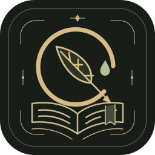
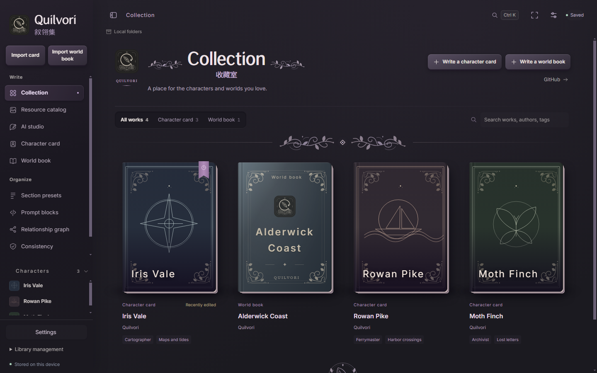
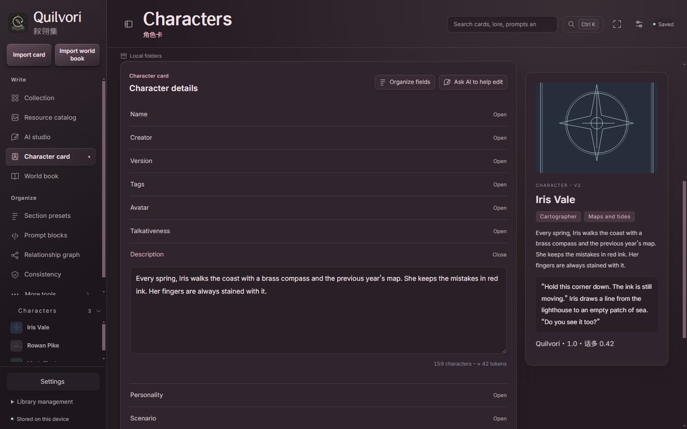
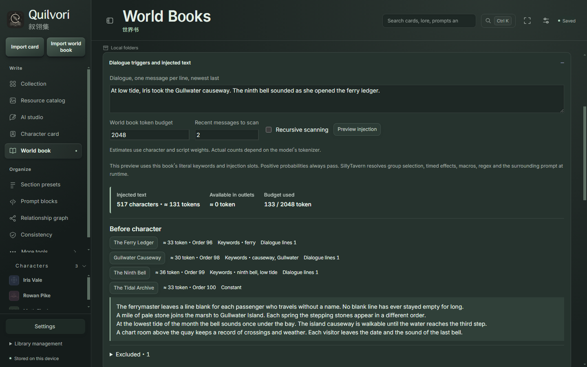

<p align="center"></p>

# Quilvori · 叙翎集

โต๊ะทำงานในเครื่องสำหรับเขียนตัวละคร สร้างโลก และจัดระเบียบโน้ตที่ปะปนกันให้กลับมาใช้งานต่อได้ ✍️

[English](README.md) · [中文](README.zh.md) · [日本語](README.ja.md) · [Русский](README.ru.md) · [한국어](README.ko.md) · **ไทย**

Quilvori ช่วยเตรียมเนื้อหาสำหรับ SillyTavern คุณสามารถแก้การ์ดตัวละครและสมุดโลก ทำงานร่วมกับโมเดลที่ตั้งค่าเอง แล้วส่งออกไปใช้ใน SillyTavern ได้ การแก้ไขด้วยตนเอง การนำเข้า การตรวจในเครื่อง และการสำรองข้อมูลใช้งานแยกจาก AI ได้ ส่วนฟังก์ชัน AI ต้องเชื่อมต่อบริการโมเดลต่างหาก

## ภาพหน้าจอ

ภาพเหล่านี้ใช้ผลงานสมมติเพื่อแสดงคลังผลงาน ตัวแก้ไขตัวละคร และการทดสอบการทำงานของหนังสือโลก

<a href="docs/screenshots/collection.png"></a>

<table>
  <tr>
    <td width="50%"><a href="docs/screenshots/character-editor.png"></a></td>
    <td width="50%"><a href="docs/screenshots/world-book-trigger.png"></a></td>
  </tr>
  <tr>
    <td align="center">ตัวแก้ไขตัวละคร</td>
    <td align="center">ตัวอย่างการทำงานของหนังสือโลก</td>
  </tr>
</table>

## ห้องสะสม สีประจำหน้า และรายการทรัพยากร

หน้าแรกจัดแสดงภาพตัวละครและปกสมุดโลกขนาดใหญ่ พร้อมค้นหา กรองประเภท ดูต้นฉบับ และเริ่มเขียนการ์ดหรือสมุดโลก หากไม่มีภาพตัวละครจะแสดงปกตัวอักษร ไม่สร้างภาพใหม่มาแทนงานของผู้สร้าง มีลายกรอบหนังสือ มุมปก และตราหนังสือประกอบบรรยากาศ

แต่ละส่วนใช้โทนสีหม่นต่างกัน: ม่วงอ่อนสำหรับห้องสะสม น้ำเงินม่วงสำหรับ AI ชมพูเทาสำหรับตัวละคร เขียวเซจสำหรับสมุดโลก แชมเปญสำหรับเครื่องมือเขียน น้ำเงินเทาสำหรับโครงสร้าง น้ำตาลอุ่นสำหรับอ่าน ม่วงพลัมสำหรับเรื่องราว ชมพูหม่นสำหรับภาพและทรัพยากร และเทากราไฟต์สำหรับเครื่องมือทั่วไป เปลี่ยนสีประจำส่วนหรือใช้สีที่กำหนดเองได้ในการตั้งค่ารูปลักษณ์และภาษา โดยเก็บสีที่บันทึกไว้เดิม

โปรไฟล์ใหม่เริ่มด้วยภาษาอังกฤษ การอัปเดตจะเก็บภาษาที่รองรับซึ่งเลือกไว้แล้ว รองรับจีน อังกฤษ ญี่ปุ่น รัสเซีย เกาหลี และไทย การสลับภาษาไม่แปลเนื้อหางานหรือชื่อผู้สร้าง

รายการทรัพยากรแสดงภาพตัวอย่างต้นฉบับ ชื่อผู้สร้าง คำอธิบาย โพสต์ต้นทาง และข้อมูลการใช้งานของการ์ด สมุดโลก และวอลเปเปอร์ ไม่ใช่สำเนาคลังส่วนตัวหรือระบบค้นหาโพสต์ Discord ใด ๆ โดยอัตโนมัติ การเข้าโพสต์อาจต้องใช้บัญชีและสิทธิ์เข้าเซิร์ฟเวอร์ของคุณ หากชอบงานสามารถฝากคำชื่นชมในโพสต์ต้นทางได้ แอปจะไม่ส่งข้อความหรือความคิดเห็นแทนคุณ

รายการที่ยังไม่ยืนยันสิทธิ์แจกต่อจะไม่แนบไฟล์ผลงานไว้ในรายการ ให้คัดลอกลิงก์ไฟล์แนบจากโพสต์ต้นทางเพื่อนำเข้า การ์ด PNG/JSON และสมุดโลก JSON มีหน้าตัวอย่างก่อนบันทึกและจำกัดดาวน์โหลด 12 MB เว็บยังขึ้นอยู่กับ CORS และต้องคัดลอกลิงก์ Discord ใหม่เมื่อหมดอายุ วอลเปเปอร์รองรับเฉพาะ PNG/JPEG/WebP ขนาดไม่เกิน 12 MB แต่ละด้านไม่เกิน 8192 พิกเซล และรวมไม่เกิน 40 ล้านพิกเซล สำเนาในเครื่องจะย่อให้ด้านยาวไม่เกิน 1600 พิกเซลและ 500 KB ส่วนภาพความละเอียดต้นฉบับให้รับจากผู้สร้าง ไม่รองรับ SVG หน้าเว็บ หรือไฟล์ธีมเป็นวอลเปเปอร์

ข้อมูลผู้สร้างและโพสต์ที่ผ่านการตรวจรูปแบบจะเก็บไว้ในส่วนพับได้ของตัวแก้ไข และส่วนขยาย `quilvori_source` เมื่อส่งออกการ์ด/สมุดโลก การมองเห็นแบบสาธารณะไม่ได้แปลว่าแจกต่อได้ และใบอนุญาต GPLv3 ของโค้ดไม่ได้ครอบคลุมงานของผู้อื่นโดยอัตโนมัติ อ่าน [แนวทางร่วมพัฒนา](CONTRIBUTING.md) ภาษาอังกฤษก่อนส่งงาน

## ทำอะไรได้บ้าง

- แก้คำอธิบาย บุคลิก ฉาก คำทักทาย ตัวอย่างบทสนทนา และคำสั่งสวมบทบาท พร้อมดูตัวอย่างทันที
- ย้ายข้อมูลตัวละครที่ปนกันไปยังช่องที่เหมาะสม โดยคงข้อความเดิมและเนื้อหาที่มีอยู่ในช่องปลายทาง
- ตั้งชื่อ จัดหมวด และเสนอคำหลักเรียกใช้ให้รายการสมุดโลก โดยไม่เขียนเนื้อหาหลักใหม่
- ให้ AI แก้เฉพาะช่อง รายการ หรือช่วงข้อความที่เลือก เปรียบเทียบก่อนใช้ และย้อนกลับได้
- เลือกแนวคิดที่ต้องการ พูดคุย และแก้ฉบับร่างปัจจุบันต่อจากเดิม
- ตรวจข้อเท็จจริง บุคลิก และลำดับเวลา พร้อมข้อความอ้างอิงและตำแหน่งต้นฉบับที่อ่านเข้าใจได้
- จัดการพรอมป์ต์ นิพจน์ปกติ คำตอบด่วน แผนผังความสัมพันธ์ เส้นเวลา และความจำ HTML

### เวิร์กช็อปธีม SillyTavern

เลือกไฟล์ JSON หรือวางลิงก์โพสต์ Discord หรือลิงก์ไฟล์แนบในเวิร์กช็อปธีม รายการมีลิงก์ต้นทางพร้อมเครดิตสำหรับ Lavender Blossoms ของ Selenis, Inkflow Radiance รุ่น PC ของ Dascard และ Solarized Light ของ GrizzyBurr หากไม่มีสำเนาในเครื่องให้รับไฟล์จากโพสต์ต้นฉบับ ปรับสี ความโปร่งใส เอฟเฟกต์เบลอ และเลือกวอลเปเปอร์เพื่อดูตัวอย่าง แล้วส่งออกเป็น ST JSON พร้อม CSS และที่มาของผู้สร้างได้

ในแอปเดสก์ท็อปให้ใส่โฟลเดอร์ติดตั้ง SillyTavern โฟลเดอร์ data หรือโฟลเดอร์ผู้ใช้ เลือกโปรไฟล์เพื่อเปิดหรือสลับธีมที่มีอยู่ หรือติดตั้งสำเนาที่แก้ไขแล้ว รีเฟรชแท็บ SillyTavern ที่เปิดอยู่เพื่อดูผล เลือกได้ว่าจะใช้ CSS ของผู้สร้างหรือไม่ ส่วนวอลเปเปอร์และ Info Board เป็นทรัพยากรแยกกัน

## เริ่มใช้งาน

ดาวน์โหลดที่เก็บโค้ด หรือใช้ Git:

```bash
git clone https://github.com/ShangguanQian/Quilvori.git
cd Quilvori
```

### เวอร์ชันเว็บ

ต้องมี Python 3 และเบราว์เซอร์รุ่นปัจจุบัน ตัวเว็บไม่ต้องติดตั้งแพ็กเกจ npm หรือผ่านขั้นตอนบิลด์

```bash
python3 -m http.server 8765 --bind 127.0.0.1
```

บน Windows ใช้คำสั่งนี้ได้เช่นกัน:

```powershell
py -m http.server 8765 --bind 127.0.0.1
```

เปิด [http://127.0.0.1:8765/](http://127.0.0.1:8765/) และให้เซิร์ฟเวอร์ทำงานอยู่ระหว่างใช้งาน หากพอร์ตถูกใช้แล้วสามารถเปลี่ยนได้ แต่คลังในเบราว์เซอร์ของแต่ละพอร์ตจะแยกกัน

เปิด `index.html` โดยตรงก็ได้ หากเบราว์เซอร์จำกัดพื้นที่เก็บข้อมูลหรือคำขอ API ของหน้าไฟล์ ให้ใช้เซิร์ฟเวอร์ HTTP ในเครื่อง ก่อนออกจากหน้าที่บันทึกไม่ได้ ให้ส่งออกข้อมูลสำรองทั้งคลัง

### เวอร์ชันเดสก์ท็อป

ตั้งแต่ 0.2 เป็นต้นไป Windows x64 จะใช้ไฟล์ `.exe` ไฟล์เดียวที่ดับเบิลคลิกเพื่อเปิดได้ทันที สำหรับ Mac ให้เลือก `arm64` สำหรับ Apple silicon หรือ `x64` สำหรับ Intel เปิดไฟล์ `.dmg` แล้วลาก **Quilvori** ไปยังโฟลเดอร์ Applications ทั้งสองรุ่นมี Electron ในตัว [ดาวน์โหลดรุ่นที่เผยแพร่](https://github.com/ShangguanQian/Quilvori/releases)

#### เปิดจากซอร์สโค้ด

ติดตั้ง Node.js 22.12 ขึ้นไปและ npm แล้วเรียกคำสั่งต่อไปนี้จากโฟลเดอร์หลักของโครงการ

```bash
npm ci
npm start
```

บน Windows หลังติดตั้งส่วนที่ต้องใช้แล้ว สามารถดับเบิลคลิก [Start-Quilvori.cmd](Start-Quilvori.cmd) ในโครงการได้ สคริปต์หาตำแหน่งโครงการจากที่อยู่ของตัวเอง จึงเรียกจากโฟลเดอร์ทำงานอื่นได้ เมื่อเปิดกระบวนการสำเร็จจะปิดหน้าต่างคำสั่ง หากล้มเหลวจะแสดงข้อผิดพลาดค้างไว้ ต้องใช้ Node.js 22.12 ขึ้นไป หากขาดส่วนที่ต้องใช้จะแนะนำให้เรียก `npm ci` ในโครงการ โดยไม่ดาวน์โหลดอัตโนมัติหรือใช้ Electron ที่ติดตั้งแบบส่วนกลาง

เวอร์ชันเดสก์ท็อปอ่านการ์ดและสมุดโลกจากโฟลเดอร์ที่เลือกได้

## ใช้งานครั้งแรก

1. คลังใหม่จะมีตัวอย่าง 「听雨楼」 ให้ลองแก้ ตรวจ และส่งออก ส่วน 「未名客」 เป็นฉบับร่างที่ตั้งใจเว้นบางช่อง
2. นำเข้าการ์ด JSON/PNG หรือสมุดโลก JSON จากแถบด้านข้าง หรือลากไฟล์ลงหน้าที่เกี่ยวข้อง
3. เปิดการจัดข้อมูลแยกช่องของการ์ด หรือการจัดระเบียบรายการสมุดโลกด้วย AI เพื่อเตรียมข้อมูลเดิม
4. ถ้าต้องการเขียนใหม่บางส่วน ให้เข้า AI สร้างสรรค์ เลือกแก้ของเดิม แล้วระบุขอบเขตให้ชัด
5. ตรวจข้อเสนอ เลือกนำไปใช้ ส่งออกเข้า SillyTavern และเก็บข้อมูลสำรองทั้งคลังไว้

การโหลดตัวอย่างและล้างคลังต้องยืนยันก่อน การโหลดตัวอย่างซ้ำจะแทนที่คลังปัจจุบัน จึงควรสำรองงานของตัวเองก่อน

## เชื่อมต่อโมเดล AI

เปิดหน้าการเชื่อมต่อโมเดลในการตั้งค่า:

1. กรอกที่อยู่หลักของ API เช่น `https://api.openai.com/v1` ไม่ใช่ URL เต็มของคำขอรายการใดรายการหนึ่ง
2. ใส่ API key ของตัวเอง เลือกโพรโทคอล แล้วเชื่อมต่อ
3. เลือกโมเดลจากรายการที่บริการส่งกลับ และลองข้อความสั้นเพื่อตรวจการเชื่อมต่อ
4. ตั้งระดับการใช้เหตุผลได้ตามต้องการ ค่าเริ่มต้นจะไม่ส่งพารามิเตอร์การใช้เหตุผลเพิ่ม ระดับที่รองรับขึ้นอยู่กับโมเดลและบริการ

รองรับ **Responses** และ **Chat Completions** ที่เข้ากันได้กับ OpenAI โหมดอัตโนมัติจะลอง Responses ก่อนและเปลี่ยนเมื่อปลายทางไม่รองรับ หากบริการรองรับเฉพาะ Chat Completions ให้เลือกโดยตรง ข้อผิดพลาดด้านการยืนยันตัวตนหรือคำตอบผิดรูปแบบจะแสดงเป็นข้อผิดพลาด

ระดับการใช้เหตุผลที่สูงขึ้นมักใช้เวลานานขึ้น ถ้าบริการไม่รับระดับที่เลือก ให้กลับไปใช้ค่าเริ่มต้นหรือระดับที่รองรับ ความพร้อมใช้งาน คุณภาพ และค่าใช้จ่ายขึ้นอยู่กับผู้ให้บริการโมเดล

แต่ละโปรไฟล์โมเดลตั้งเวลารอข้อมูลได้ 1–60 นาที ค่าเริ่มต้นคือ 5 นาที ระบบจะเริ่มนับใหม่ทุกครั้งที่ได้รับข้อมูล บันทึกงานจะแสดงว่าหมดเวลาขณะรอข้อมูลชุดแรกหรือการรับข้อมูลหยุดกลางทาง

งานที่ทำด้วยตนเองใช้งานแบบออฟไลน์ได้ เมื่อเรียก AI เพื่อสร้าง จัดระเบียบ สนทนา หรือตรวจ ข้อความต้นฉบับ ข้อมูลอ้างอิง คำขอ และบทสนทนาที่เกี่ยวข้องจะถูกส่งไปยัง API ที่ตั้งไว้ แอปเดสก์ท็อปเข้ารหัสคีย์โมเดลด้วยการป้องกันระดับผู้ใช้ของ Windows หรือพวงกุญแจของ macOS รุ่นเว็บใช้กุญแจ Web Crypto ที่ส่งออกไม่ได้และเก็บไว้ใน IndexedDB ของเบราว์เซอร์ การย้ายข้อมูลจะตรวจสอบว่าถอดรหัสคีย์ทุกชุดได้ก่อนแทนที่ข้อมูลเดิม คีย์โมเดลไม่รวมอยู่ในการ์ดที่ส่งออกหรือข้อมูลสำรองทั้งคลัง

## รูปแบบการทำงานกับ AI

### แก้เนื้อหาที่มีอยู่

เลือกการ์ดหรือสมุดโลก แล้วเลือกช่องหรือรายการที่อนุญาตให้แก้ สามารถเลือกเพียงช่วงข้อความได้ ข้อมูลส่วนอื่นใช้ประกอบการอ้างอิง และมีภาพเปรียบเทียบข้อความก่อนกับหลัง

ช่องที่โมเดลไม่ส่งกลับจะคงค่าเดิม การล้างช่องที่มีข้อมูลต้องอนุญาตต่างหาก คำถามขอข้อมูลเพิ่ม คำตอบไม่ครบ การแก้นอกขอบเขต หรือการเปลี่ยนต้นฉบับระหว่างรอจะไม่เขียนทับงานโดยอัตโนมัติ การย้อนกลับก็ตรวจไม่ให้ทับการแก้ด้วยตนเองที่เกิดขึ้นภายหลัง

### สร้างฉบับร่างและแก้ต่อ

เขียนแนวคิดแล้วเริ่มสร้างได้เลย จะตอบคำถามหรือเลือกแนวคิดที่เสนอมาก็ได้ ระบบจะใช้เฉพาะคำตอบที่กรอกและแนวคิดที่เลือก

การสนทนาใช้ฉบับร่างปัจจุบันและแนวคิดที่เลือกไว้ ระหว่างสร้าง สนทนา จัดระเบียบ หรือตรวจงาน คุณเปิดหน้าอื่นในหน้าต่างเดิมได้ เมื่อกลับมาที่ผลงานต้นทางจะเห็นความคืบหน้าหรือผลลัพธ์ นอกจากนี้ยังแก้เฉพาะช่องของการ์ดหรือรายการในสมุดโลกที่เลือกได้

การ์ดตัวละครและสมุดโลกที่สร้างใหม่จะบันทึกเป็นฉบับร่างในเครื่อง เปิด «ฉบับร่าง AI ที่รอตรวจ» ในคลังหรือหน้าแก้ไขของผลงานนั้น ตรวจเนื้อหาแล้วกดยอมรับ จากนั้นใช้ «เปิดผลงานในคลัง» เพื่อไปยังผลงานที่บันทึก หากกลุ่ม บท หรือแผนผังความสัมพันธ์อ้างถึงตัวละครใหม่ ให้รับการ์ดตัวละครนั้นเข้าคลังก่อน

เมื่อโมเดลส่งการ์ดตัวละครและหนังสือโลกมาพร้อมกัน ระบบจะตรวจผลงานที่เลือกทีละชิ้น ผลงานที่ผ่านจะอยู่ในฉบับร่างแม้อีกชิ้นต้องแก้ไข ค่าเริ่มต้นจะเก็บคำตอบสำหรับการ์ดและหนังสือโลกที่มีเนื้อหา 24 ครั้งล่าสุดไว้บนอุปกรณ์ เปิดบันทึกงานในสตูดิโอ AI เพื่อกู้ฉบับร่าง หรือวางคำตอบที่คัดลอกไว้จากรุ่นก่อน การกู้คืนทำบนเครื่อง การพูดคุยรองรับคำตอบข้อความธรรมดา และใช้คำตอบล่าสุดแก้ไขฉบับร่างได้ทันที

### ตรวจตรรกะและบุคลิก

ผลตรวจจากกฎในเครื่องและ AI แยกกัน รายงานมีข้อสรุปที่เข้าใจง่าย เหตุผล และแนวทางจัดการ พร้อมตำแหน่งช่องของการ์ด หรือ 「สมุดโลก → รายการ → ช่อง → บรรทัด」

เปิดต้นฉบับเพื่อตรวจแล้วกลับมาที่รายงานได้ รายงานเก็บตำแหน่งอ้างอิงเมื่อสร้างและแจ้งให้ตรวจใหม่เมื่อข้อความเปลี่ยน ช่องเสริมที่ว่างจะแสดงเป็นหมายเหตุ การระบุข้อขัดแย้งต้องมีข้อความต้นฉบับที่ระบุตำแหน่งได้อย่างน้อยสองตอนที่แตกต่างกัน หากมีเพียงตอนเดียวหรือช่วงข้อความซ้อนกัน ทั้งรายงานและไฟล์ JSON ที่ส่งออกจะแสดงว่าต้องยืนยัน การตรวจเองไม่แก้ต้นฉบับ

สมุดโลกขนาดใหญ่แบ่งตรวจเป็นชุดของรายการที่เลือกได้ และระบุขอบเขตไว้ บันทึกงานแยกสถานะ เหตุผลที่บริการส่งกลับ และผลลัพธ์ หากโมเดลไม่ส่งส่วนเหตุผลก็จะแจ้งตามนั้น

## จัดข้อมูลการ์ดแยกช่อง

เปิดการจัดข้อมูลในหน้าแก้การ์ด ใส่แนวทางเพิ่มเติมได้ แล้วขอดูตัวอย่าง

- พิจารณาคำอธิบาย บุคลิก ฉาก คำทักทายแรก ตัวอย่างสนทนา พรอมป์ต์ระบบ คำสั่งหลังประวัติ และโน้ตผู้สร้าง
- แต่ละข้อแสดงช่องต้นทาง ปลายทาง เหตุผล และข้อมูลก่อนกับหลังแยกตามช่อง
- ย้ายข้อความเดิมตามตัวอักษรไปต่อท้ายข้อมูลเดิมในช่องปลายทาง ส่วนที่ไม่เลือกหรือจัดหมวดไม่ได้จะอยู่ที่เดิม
- การนำข้อความออกจากต้นทางและเพิ่มที่ปลายทางทำพร้อมกัน หากข้อความอ้างอิงไม่ตรง ช่วงซ้อนกัน หรือต้นฉบับเปลี่ยน จะไม่ใช้ข้อเสนอนั้น

ฟังก์ชันนี้จัดระเบียบข้อมูลที่มีอยู่ ไม่แต่งประวัติที่ขาดหาย โปรดตรวจหมวดที่เสนอ และเว้นช่องเสริมว่างได้เมื่อไม่จำเป็น

## จัดชื่อ หมวด และคำหลักของสมุดโลก

เลือกจัดเฉพาะรายการปัจจุบัน รายการที่ไม่มีชื่อหรือขาดคำเรียกใช้ หรือทุกรายการในสมุดโลกนี้ได้ ในหน้าแก้รายการมีทางเข้าเพื่อจัดเพียงรายการเดียวด้วย

- หมวดได้แก่ ตัวละคร ความสัมพันธ์ สถานที่ องค์กร กฎ ประวัติศาสตร์ สิ่งของ โครงเรื่อง และอื่น ๆ สามารถจัดกลุ่มสารบัญตามหมวดเนื้อหาได้
- ค่าเริ่มต้นเติมชื่อให้เฉพาะรายการใหม่หรือไม่มีชื่อ ถ้าจะเปลี่ยนชื่อเดิมต้องเปิดตัวเลือกอนุญาต
- คำหลักหลักมาจากเนื้อหาหรือชื่อเดิมของรายการ เมื่อใช้ข้อเสนอจะเพิ่มคำใหม่และคงคำหลักเดิมกับคำรองทั้งหมดไว้
- รายการที่เปิดตลอดอาจไม่มีคำหลักได้ การเปลี่ยนวิธีเรียกใช้ต้องเปิดสิทธิ์อนุญาตต่างหาก
- หากเปลี่ยนเป็นโหมดคำหลัก จะต้องมีคำหลักหลักอย่างน้อยหนึ่งคำ งานจัดระเบียบไม่รีเซ็ตเนื้อหา สถานะเปิดใช้ เงื่อนไขคำรอง ตำแหน่งแทรก ความลึก หรือลำดับ

แต่ละข้อมีหลักฐานและเหตุผล เลือกใช้แยกตามรายการและย้อนกลับได้ หมวดจะส่งออกผ่านฟิลด์ส่วนขยาย `realmweave_category` ในสมุดโลกทั่วไปและแบบฝังในการ์ด โดยไม่แทนค่าการเรียกใช้ของ SillyTavern

## หน้าและเครื่องมือ

| หน้า | การใช้งาน |
| --- | --- |
| ห้องสะสม | ปกขนาดใหญ่ ค้นหา กรอง ดูต้นฉบับ และเริ่มเขียน |
| รายการทรัพยากร | ตรวจผู้สร้างและโพสต์ต้นทาง แล้วดูตัวอย่างก่อนนำเข้าการ์ด สมุดโลก หรือวอลเปเปอร์ |
| การ์ดตัวละคร | แก้ช่องของ SillyTavern และนำเข้า/ส่งออก JSON หรือ PNG การ์ด |
| สมุดโลก | แก้รายการและค่าการแทรก ทดลองเรียกใช้ จัดกลุ่มตามตำแหน่งหรือเนื้อหา |
| AI สร้างสรรค์ | แก้เฉพาะส่วน สร้างร่าง สนทนา ตรวจ และดูตัวอย่างก่อนใช้ |
| ชุดการเขียน | จัดสไตล์ มุมมอง ความสัมพันธ์ ขอบเขต และรูปแบบผลลัพธ์ |
| ประกอบพรอมป์ต์ | จัดลำดับและเปิดปิดบล็อกพรอมป์ต์ |
| สมาชิกกลุ่ม | เลือกตัวละคร ฉาก ความช่างพูด และวิธีเข้าร่วม |
| อ่านแชต | อ่าน JSONL หรืออาร์เรย์ข้อความ ค้นหา บุ๊กมาร์ก และคัดลอก |
| สื่อ | เก็บรูปประจำตัว สีหน้า และพื้นหลังไว้ในคลัง |
| สคริปต์ Regex | ใส่ข้อความต้นฉบับ ผลลัพธ์ที่ต้องการ และตัวอย่างที่ควรคงเดิมหากมี ทดสอบแม่แบบในเครื่องหรือให้ AI สร้างกฎจากตัวอย่าง แล้วส่งออกสคริปต์สำหรับส่วนขยาย Regex |
| คำตอบด่วน | สร้างชุดทั่วไปหรือระบุการ์ดตัวละครและสมุดโลกเป็นแหล่งอ้างอิง ให้ระบบเลือกรายการที่เกี่ยวข้องหรือเลือกเอง ตรวจปุ่มและข้อความก่อนส่งออกเป็น Quick Reply v2 |
| บันทึกเรื่องราว | วางโครงฉากหรือผูกบันทึกและเหตุการณ์กับข้อความในแชตที่นำเข้า เปิดข้อความต้นทางจากบันทึก หรือเปิดบันทึกที่เชื่อมไว้จากข้อความนั้นได้ |
| แผนผังความสัมพันธ์ | แก้จุดตัวละครและเส้นเชื่อม ส่งออกเป็นสมุดโลก |
| ตรวจความสอดคล้อง | อ่านรายงานในเครื่อง/AI และเปิดตำแหน่งต้นฉบับ |
| บทสนทนากลุ่ม | เรียงบทพูด คำบรรยาย และคำเรียกใช้ |
| ความจำ HTML | สร้างความจำ HTML สำหรับ JS-Slash-Runner |
| สำรองทั้งคลัง | ส่งออกข้อมูลทั้งหมด และกู้คืนแบบแทนที่หรือรวม |
| คู่มือ | วิธีใช้และที่นำไฟล์ส่งออกไปใช้งาน |

หน้าตา ภาษา แนวทางการเขียน และโมเดลอยู่ในการตั้งค่า หน้าภาษาจีนใช้ฟอนต์ Sarasa ที่แนบในเครื่อง รองรับอินเทอร์เฟซหกภาษา การเปลี่ยนภาษาไม่แปลหรือแก้ข้อความที่เขียนไว้

## นำเข้าและส่งออกไป SillyTavern

| เนื้อหา | รูปแบบและปลายทาง |
| --- | --- |
| การ์ด | JSON หรือ PNG ที่มี `chara`/`ccv3` ใช้เมนูนำเข้าตัวละครของ SillyTavern และแนบสมุดโลกตอนส่งออกได้ |
| สมุดโลก | World Info JSON หรืออาร์เรย์ `entries` ของสมุดตัวละคร นำเข้าผ่าน World Info |
| Regex | อาร์เรย์ JSON นำเข้าผ่านส่วนขยาย Regex |
| คำตอบด่วน | Quick Reply v2 JSON นำเข้าผ่านส่วนขยายที่เกี่ยวข้อง |
| สีหน้า | วางภาพในโฟลเดอร์ `expressions` ของตัวละคร สมุดโลกบันทึกเพียงชื่อชุด ไม่รวมภาพ |
| พรอมป์ต์ | ค่าบล็อกสำหรับเทียบกับพรีเซ็ต ไม่ใช่ API พรีเซ็ตเต็มที่เขียนทับโมเดลและอุณหภูมิ |
| สมาชิกกลุ่ม | รายชื่อสำหรับสร้างกลุ่มหลังนำเข้าตัวละคร ไม่ใช่ไฟล์กลุ่มสากลที่นำเข้าได้ทันที |
| แชต บันทึกเรื่องราว และบท | ไฟล์สำหรับอ่านและวางแผนใน Quilvori หากต้องการส่งคำสั่งให้โมเดลผ่าน Author’s Note ให้ตั้งค่าในแชตที่เกี่ยวข้องของ SillyTavern |
| ความจำ HTML | นำเข้าเป็นสคริปต์ HTML ใน JS-Slash-Runner |
| สำรองทั้งคลัง | JSON คลัง Quilvori ไม่ใช่ข้อมูลสำรองทั้งเซิร์ฟเวอร์ SillyTavern |

### อ่านโฟลเดอร์ในเครื่อง

ในแอปเดสก์ท็อป เปิดส่วนโฟลเดอร์ในเครื่อง เลือกโฟลเดอร์การ์ดและสมุดโลก แล้วอ่านไฟล์เดิม ระบบอ่านการ์ด JSON/PNG และสมุดโลก JSON ที่อยู่ระดับบนสุดของโฟลเดอร์ที่เลือก รวมทั้งสมุดที่ฝังในการ์ด

แม้จะเปลี่ยนเฉพาะภาพตัวละครในการ์ด PNG ระบบก็จะเพิ่มเป็นอีกเวอร์ชันและเก็บงานที่แก้ในเครื่องไว้ เมื่อสแกนเวอร์ชันเดิมซ้ำ ระบบจะใช้การ์ดที่มีอยู่ ไฟล์เสียหนึ่งไฟล์ไม่หยุดการนำเข้าอื่น และมีรายละเอียดข้อผิดพลาด ภาพใหญ่จะถูกย่อ หากพื้นที่ไม่พอ ระบบจะบันทึกข้อความก่อน เมื่อเพิ่มพื้นที่ว่างแล้ว สแกนอีกครั้งเพื่อนำเข้าภาพที่ขาด การอ่านไม่แก้ไฟล์การ์ดหรือสมุดโลกต้นทาง เมื่อส่งออกภาพสีหน้าในแอปเดสก์ท็อป ให้ตรวจรายชื่อไฟล์เดิมก่อนยืนยันการแทนที่ หากเขียนไฟล์ล้มเหลว แอปจะคืนไฟล์เดิม หากโปรแกรมอื่นขัดขวางการกู้คืน แอปจะแสดงโฟลเดอร์ที่เก็บสำเนาสำรองและรายการไฟล์

### นำเข้าการ์ดตัวละครและสมุดโลกจากลิงก์

ในหน้าสมุดโลก เลือกนำเข้าจากลิงก์แล้วอ่าน URL แบบ HTTPS สาธารณะ รองรับ JSON สมุดโลก หน้าไฟล์ GitHub ที่เจาะจง และการ์ด JSON/PNG ที่มีสมุดโลกฝังอยู่ โดยดึงเฉพาะสมุดโลกจากการ์ด

หน้าการ์ดตัวละครก็นำเข้าจากลิงก์ได้ โดยรองรับ JSON การ์ดและ PNG ที่มีข้อมูลการ์ด ดูรูปประจำตัว ข้อความแต่ละช่อง และคำทักทายสำรองก่อนเลือกว่าจะนำเข้าสมุดโลกที่ฝังมาด้วยหรือไม่ ช่องว่างที่ไม่บังคับยังคงว่าง และรูป PNG จะย่อเพื่อจัดเก็บ สมุดโลกที่นำเข้าด้วยจะถูกเลือกในส่วนส่งออก สามารถนำเข้าเฉพาะการ์ดก่อน แล้วอ่านลิงก์เดิมภายหลังเพื่อเพิ่มสมุดโลกโดยเก็บข้อความที่แก้เองไว้

ดูชื่อ รายการ จำนวนที่เปิดตลอดและยังไม่มีชื่อก่อนบันทึก ค้นหาในต้นฉบับและเปลี่ยนชื่อที่จะบันทึกได้ เนื้อหาซ้ำจะเปิดเล่มเดิมพร้อมเก็บการแก้ไขในเครื่อง ส่วนข้อมูลใหม่จากแหล่งเดิมจะบันทึกแยกเล่ม ย้อนกลับจากการแจ้งเตือนได้ แต่จะไม่ลบการแก้ไขที่ทำภายหลัง

การ์ดจะข้ามรายการซ้ำและบันทึกเวอร์ชันใหม่แยกเช่นกัน การย้อนกลับจะคืนการเพิ่มการ์ด รูป และสมุดโลกจากการนำเข้าครั้งนั้น หากแก้ไขต่อแล้วหรือมีข้อมูลอื่นอ้างอิง ระบบจะหยุดการย้อนกลับเพื่อเก็บงานไว้

สำหรับ Discord ให้คัดลอกลิงก์ดาวน์โหลดไฟล์แนบ JSON/PNG การค้นหาไฟล์จากโพสต์หรือช่องต้องมีสิทธิ์จากเซิร์ฟเวอร์และเชื่อมบอตต่างหาก หากลิงก์หมดอายุให้คัดลอกใหม่จากโพสต์ต้นทาง การนำเข้าไฟล์แนบไม่ต้องใช้ Discord Token ส่วนบุคคลและไม่เรียก AI

จำกัด 12 MB พร้อมหยุดอ่านและจัดการหมดเวลา แอปเดสก์ท็อปดาวน์โหลดไฟล์ HTTPS สาธารณะ โดยให้ GitHub และไฟล์แนบ Discord CDN ใช้พร็อกซีของระบบก่อน ส่วนเว็บขึ้นอยู่กับ CORS ของต้นทาง หากถูกจำกัดให้ใช้แอปหรือดาวน์โหลดแล้วนำเข้าไฟล์ ที่อยู่แหล่งไฟล์ที่บันทึกจะตัดพารามิเตอร์ค้นหา จึงไม่เก็บลายเซ็นดาวน์โหลดชั่วคราวในคลัง

## การเก็บข้อมูล สำรอง และอัปเดต

คลังเก็บใน `IndexedDB` ของเบราว์เซอร์หรือแอปปัจจุบัน ไม่คอมมิตขึ้น GitHub อัตโนมัติ โปรไฟล์เบราว์เซอร์ พอร์ต `localhost` กับ `127.0.0.1` หน้าไฟล์ และ Electron อาจมีคลังคนละชุด ควรใช้ทางเข้าเดิมเสมอ และย้ายข้อมูลด้วยการส่งออก/กู้คืนทั้งคลัง การเปิดครั้งแรกจะย้ายคลังเดิมจาก localStorage และเก็บสำเนาต้นฉบับไว้

IndexedDB v6 เก็บผลงานแต่ละชิ้นแยกเป็นระเบียน แก้ไขฟิลด์ในการ์ดแล้วระบบจะบันทึกการ์ดนั้นและข้อมูลรุ่น ภาพและเนื้อหาข้อความแชตเก็บแยกกัน การเปลี่ยนชื่อภาพหรือแก้บุ๊กมาร์กจึงเขียนเฉพาะข้อมูลกำกับ การนำเข้าหรือแทนที่ทั้งคลังยังตรวจสอบข้อมูลทั้งหมดก่อนบันทึก

เมื่อเปิดคลัง v5 ฐานข้อมูลจะอัปเกรดเป็น v6 หากยังต้องใช้รุ่น 0.2.0 ด้วย ให้ปิดแอปก่อนอัปเกรดและเก็บสำเนาโปรไฟล์ผู้ใช้ v5 ทั้งโฟลเดอร์แยกไว้

JSON สำรองทั้งคลัง (`backupVersion: 2`) อ่านผลงาน แบบร่างการ์ดและเวิลด์บุ๊กที่ยังไม่รับเข้าคลัง สแนปช็อตของทั้งผลงานปัจจุบันและผลงานที่ลบแล้ว กฎการเก็บรายชิ้น และคำตอบต้นฉบับของโมเดลในธุรกรรม IndexedDB เดียว การแทนที่จะกู้คืนทั้งหมดพร้อมกัน การรวมจะข้ามรายการซ้ำและแยกแบบร่างหรือคำตอบที่รหัสชนกันแต่เนื้อหาต่างกัน เพดานเก็บสแนปช็อตจะขยายให้เก็บประวัติที่รวมได้ครบ ถ้ามีคำตอบเกิน 24 รายการหลังรวม ระบบจะเก็บทั้งหมดและขยายจำนวนรายการล่าสุดที่เก็บต่อไปเป็นจำนวนดังกล่าว ไฟล์แบบเก่าที่มีเฉพาะผลงานจะคงบันทึกงานในเครื่องไว้ โปรไฟล์การเชื่อมต่อโมเดล คีย์ API และการเลือกโฟลเดอร์เก็บอยู่บนอุปกรณ์ ไฟล์สำรองมีต้นฉบับส่วนตัวและข้อความที่โมเดลตอบกลับ

เปิดประวัติเวอร์ชันแล้วเลือกจัดการสแนปช็อตของผลงานเพื่อดูจำนวนและขนาดเนื้อหาโดยประมาณ ก่อนกำหนดจำนวนที่จะเก็บหรือล้างประวัติ ให้ตรวจสอบวันที่ของรายการที่จะลบแล้วจึงยืนยัน เว้นช่องจำนวนว่างไว้เพื่อเก็บได้ไม่จำกัด จำนวนที่กำหนดมีผลกับสแนปช็อตที่บันทึกเองและสแนปช็อตอัตโนมัติในอนาคต ขนาดคำนวณจาก JSON แบบ UTF-8 โดยไม่รวมพื้นที่จัดการของฐานข้อมูล ในหน้าสำรองข้อมูลทั้งคลัง ส่วนพื้นที่สแนปช็อตทั้งคลังจะแสดงยอดรวม และให้ตรวจสอบสแนปช็อตของผลงานที่ลบแล้วก่อนตัดสินใจล้าง

การทดสอบพื้นที่จัดเก็บของ `npm run test:ui` บันทึกฟิลด์เดิม 5 ครั้งกับคลังที่ใช้ภาพและแชตสังเคราะห์ขนาด 64 KiB และ 16 MiB แล้วแสดงเวลามัธยฐานที่ใช้รับข้อมูลและบันทึก นอกจากนี้ยังวัดการเติบโตของสแนปช็อตเมื่อเพิ่มเนื้อหา 8 KiB ในผลงานเดิม 5 ครั้ง ผลขึ้นอยู่กับอุปกรณ์และข้อมูลทดสอบ

เมื่อนำไฟล์แชตที่ส่งออกแยกไว้กลับเข้ามา ข้อความ บุ๊กมาร์ก และส่วนหัวเดิมของ SillyTavern จะกลับมาด้วย ก่อนลบตัวละคร คุณสามารถดูจุดที่อ้างอิงถึงตัวละครนั้น เลิกเชื่อมโยง เปลี่ยนเป็นตัวละครอื่น หรือเก็บชื่อผู้พูดเดิมไว้ในบทได้ หลังลบการ์ดตัวละคร เวิลด์บุ๊ก รูปภาพ แชต กลุ่ม นิพจน์ปรกติ หรือชุดตอบกลับด่วน สามารถกดเลิกทำในข้อความแจ้งเตือน

ก่อนรวมข้อมูลสำรอง ให้เปิดฟิลด์ที่ขัดแย้งเพื่อเทียบย่อหน้าที่ต่างกัน เลือกเก็บค่าปัจจุบัน (ค่าเริ่มต้น) ใช้ค่าจากข้อมูลสำรอง หรือเก็บทั้งสองฉบับแยกกัน หากเลือกเก็บแยกหลายฟิลด์ในผลงานเดียว จะได้สำเนาผลงานเพียงหนึ่งชิ้นพร้อมรหัสใหม่ แชตที่แยกเป็นคนละฉบับจะเก็บบุ๊กมาร์กของแต่ละฉบับ เปิดดูสำเนาการตั้งค่าและหน่วยความจำ HTML ได้ที่หน้าสำรองข้อมูล การยกเลิกที่หน้าตัวอย่างจะคงคลังปัจจุบันไว้

แอป Windows ยังคงใช้ `%APPDATA%\nijan` สำหรับโปรไฟล์และ `folders.json` เพื่อให้ใช้ข้อมูลเดิมต่อได้ ชื่อโครงการที่แสดงคือ Quilvori / 叙翎集

ข้อมูลสำรองมีการ์ด สมุดโลก รูปภาพ และงานเขียนของคุณ เก็บไว้ในที่ที่ควบคุมได้และสำรองก่อนเปลี่ยนเครื่อง เบราว์เซอร์ พอร์ต หรือเวอร์ชัน กฎละเว้นของ Git ครอบคลุมโฟลเดอร์ข้อมูลทั่วไป แต่ยังควรตรวจไฟล์ที่เตรียมคอมมิตเพื่อไม่ให้งานส่วนตัวและคีย์ปะปนในซอร์ส

เมื่อไม่มีการแก้โค้ดในเครื่องที่ยังจัดการไม่เสร็จ อัปเดตได้ด้วย:

```bash
git pull --ff-only
npm ci
```

จากนั้นเปิดแอปใหม่หรือรีเฟรชเว็บ ถ้าใช้เฉพาะเว็บไม่ต้องเรียก `npm ci` ส่วนโค้ดที่แก้เองควรบันทึกและจัดการก่อนอัปเดต

## ปัญหาที่พบบ่อย

**รายการการ์ดว่าง** ตรวจว่าใช้เบราว์เซอร์ พอร์ต หรือแอปเดิมหรือไม่ เวอร์ชันเว็บต้องนำเข้าไฟล์ ส่วน Electron อ่านโฟลเดอร์ที่ตั้งไว้ได้ การเลือกโฟลเดอร์ไม่ทำให้คลังแชร์กับทุกเบราว์เซอร์

**นำเข้า PNG ไม่ได้** ภาพทั่วไปไม่ใช่การ์ด ต้องมีข้อมูลตัวละครที่ถูกต้อง หรือใช้ JSON ที่ส่งออกจาก SillyTavern

**เชื่อมต่อหรือสร้างไม่สำเร็จ** ตรวจ URL คีย์ โมเดล และโพรโทคอล หากบริการใช้เฉพาะ Chat Completions ให้เลือกตรง ๆ การอนุญาตคำขอข้ามต้นทางของเบราว์เซอร์ขึ้นอยู่กับบริการ ถ้าคำตอบขาดหรือข้อมูลยาวเกินไป ให้ลดขอบเขตและแบ่งทำเป็นชุด

**ระดับการใช้เหตุผลถูกปฏิเสธ** ใช้ค่าเริ่มต้นของโมเดลหรือระดับที่รองรับ โมเดลแต่ละตัวอาจรับพารามิเตอร์ไม่เหมือนกัน

**พื้นที่เก็บเต็ม** ส่งออกข้อมูลสำรองก่อน แล้วลดภาพขนาดใหญ่ อย่าล้างข้อมูลเบราว์เซอร์ก่อนตรวจว่าสามารถกู้คืนได้

**ทำไมไม่เขียนกลับเข้า SillyTavern อัตโนมัติ** คลังของเครื่องมือนี้กับไฟล์ SillyTavern แยกกัน ให้ส่งออกงานแล้วนำเข้าผ่านหน้าที่ตรงกัน

## ทดสอบและโครงสร้างซอร์ส

```bash
npm run validate
```

`npm run check` ตรวจไวยากรณ์ JavaScript, `npm test` ตรวจพฤติกรรม และ `npm run validate` เรียกทั้งสองอย่าง CI ตรวจบน Node.js 22 และ 24 ใน Ubuntu และ Windows

การทดสอบใช้ข้อมูลตัวอย่างและ API จำลอง ไม่เรียกโมเดลเสียเงินจริง ครอบคลุมรูปแบบไฟล์ การกันซ้ำ การย้ายข้อความ เมทาดาทา ขอบเขตแก้ไข ช่องว่าง ตัวอย่างที่ล้าสมัย การใช้/ย้อนกลับ หลักฐาน โพรโทคอล พารามิเตอร์การใช้เหตุผล และภาษา

`js/` เก็บหน้าตา โมเดลข้อมูล และขั้นตอน AI; `electron/` เชื่อมไฟล์ของเดสก์ท็อป; `css/` เก็บสไตล์; `test/` เก็บการตรวจอัตโนมัติ ตัวเว็บใช้สคริปต์ทั่วไปและไม่ต้องมีเครื่องมือรวมบันเดิล

## ใบอนุญาต

Quilvori ใช้ **GNU General Public License รุ่น 3 เท่านั้น** โดยมีตัวระบุ SPDX เป็น **GPL-3.0-only** อ่านเงื่อนไขฉบับเต็มใน [LICENSE](LICENSE) ขอบเขตและประวัติใน [LICENSING.md](LICENSING.md) และประกาศผู้ถือสิทธิ์กับบุคคลที่สามใน [NOTICE](NOTICE)

อนุญาตให้ใช้ แก้ไข และแจกจ่าย รวมถึงใช้เชิงพาณิชย์ เมื่อแจกจ่ายเวอร์ชันดัดแปลงที่อยู่ภายใต้ใบอนุญาต งานดัดแปลงส่วนที่ครอบคลุมต้องคง GPLv3 เก็บประกาศที่จำเป็น และให้ซอร์สโค้ดที่สอดคล้องกัน (Corresponding Source) ตามเงื่อนไขของใบอนุญาต การแก้ไขและใช้เป็นการส่วนตัวไม่ได้ทำให้ต้องเผยแพร่ซอร์สต่อสาธารณะโดยทั่วไป และไม่มีข้อจำกัดเพิ่มว่าต้องใช้แบบไม่แสวงหากำไรเท่านั้น

สิทธิ์ที่เคยให้กับรุ่นก่อนหน้าซึ่งแจกจ่ายภายใต้ MIT ไม่ถูกเพิกถอนจากการเปลี่ยนครั้งนี้ รุ่นปัจจุบันใช้ GPL-3.0-only โดยไม่มีตัวเลือก “หรือรุ่นที่ใหม่กว่า” ดู[ประวัติใบอนุญาต](LICENSING.md)เพิ่มเติม

ฟอนต์ ภาพ และผลงานของบุคคลที่สามยังใช้เงื่อนไขของเจ้าของแต่ละราย Sarasa มี[ใบอนุญาตฟอนต์](fonts/OFL-Sarasa.txt)แยกต่างหาก ภาพตัวอย่างทรัพยากร**ไม่ได้รับอนุญาตภายใต้ GPLv3 ของแอป** และไม่พบสิทธิ์แจกจ่ายภายนอกแบบทั่วไปในโพสต์ผู้สร้างที่ตรวจแล้ว ดูเครดิต ต้นทาง และสถานะใน[รายการเครดิตภาพ](img/resources/ATTRIBUTION.md) ใบอนุญาตโครงการไม่ได้ให้สิทธิ์เพิ่มเติมในการแจกจ่ายผลงานเหล่านั้น
