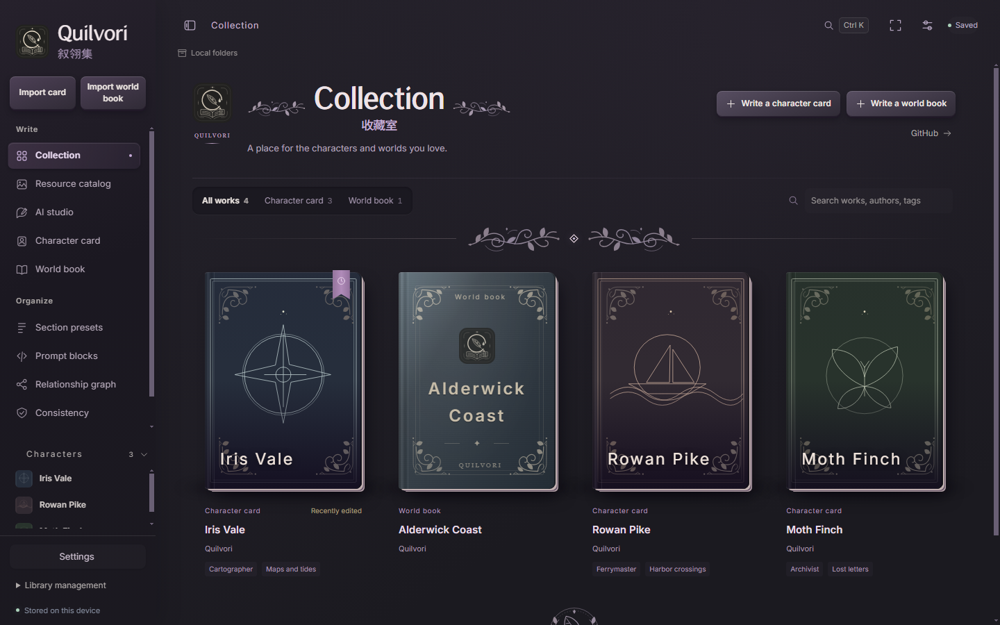
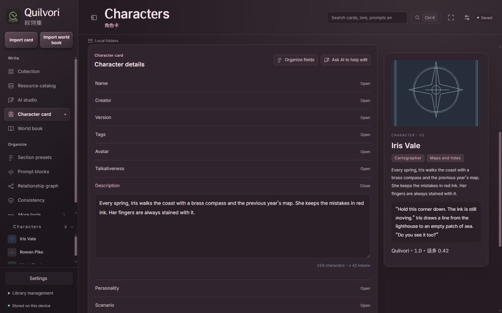
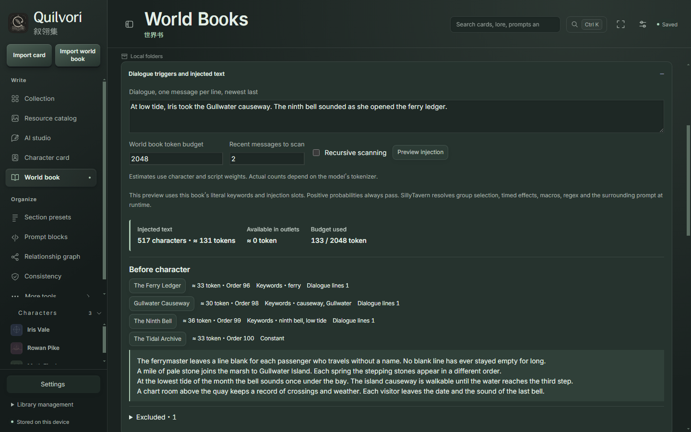

<p align="center"></p>

# Quilvori · 叙翎集

写角色、搭世界，也把散乱的设定整理成能继续用的稿子。✍️

[English](README.md) · **中文** · [日本語](README.ja.md) · [Русский](README.ru.md) · [한국어](README.ko.md) · [ไทย](README.th.md)

Quilvori 是为 SillyTavern 素材准备的本地写作工作台。你可以编辑角色卡、整理世界书、连接自己的模型一起改稿，再导出到 SillyTavern。手动编辑、导入、检查和备份等本地功能可以独立使用；AI 功能需要另行配置模型服务。

## 界面实拍

下图使用专为演示制作的虚构作品，展示收藏室、角色卡编辑器和世界书触发测试。

<a href="docs/screenshots/collection.png"></a>

<table>
  <tr>
    <td width="50%"><a href="docs/screenshots/character-editor.png"></a></td>
    <td width="50%"><a href="docs/screenshots/world-book-trigger.png"></a></td>
  </tr>
  <tr>
    <td align="center">角色卡编辑器</td>
    <td align="center">世界书触发测试</td>
  </tr>
</table>

## 收藏室、分区配色与资源目录

点击封面标题旁的图钉，可以把常用角色卡或世界书放到书架前排。取消置顶后，作品回到原有次序。整库备份会保存置顶状态，导出到 SillyTavern 的作品只包含作品内容。

首页以大封面收藏画廊展示角色卡和世界书，支持搜索、分类、原文预览，并保留“写角色卡”“写世界书”入口。角色卡使用已有肖像；缺少肖像时显示文字书封，不生成替代作品。标题花边、书封角花和藏书章呼应书卷氛围。

各页面使用柔和的分区配色：收藏室雾紫、AI 创作蓝紫、角色卡豆沙灰、世界书鼠尾草绿、写作工具香槟灰、结构工具石板蓝、阅读区暖墨棕、叙事区灰葡萄紫、素材与资源区烟粉灰、工具区石墨灰。可在“设置 → 外观与语言”切换“按功能分区配色”或自定义颜色；已有自定义主题会保留。

新用户首次使用默认英语；升级会保留已保存且受支持的语言选择。界面支持中、英、日、俄、韩、泰六语，切换语言不会翻译或改写作品正文、标题和作者信息。

“资源目录”展示作者原图预览、署名、简介、原帖和使用说明，包含角色卡、世界书与壁纸。它不是私人资料库镜像，也不自动抓取任意 Discord 帖子。访问原帖可能需要自己的账号和服务器权限。喜欢作品时，可以到原帖留言支持作者；软件不会代发评论。

没有明确转载授权的条目只提供来源目录，导入时需要从作者原帖复制附件链接。角色卡 PNG/JSON 和世界书 JSON 先预览再导入，下载上限 12 MB；网页版还受来源网站的跨域设置限制。Discord 附件过期后需重新复制链接。壁纸仅接受 PNG、JPEG、WebP，输入上限 12 MB、单边 8192 像素、总像素 4000 万；本地保存副本会压到长边不超过 1600 像素、500 KB，原始高清图请到作者处获取。SVG、网页和主题文件不作为壁纸导入。

导入会保留清洗后的作者和原帖信息，在编辑器中折叠展示，并通过角色卡／世界书的 `quilvori_source` 扩展字段保留。公开可见不等于允许转载，资源作品也不会因此适用仓库的 GPLv3 许可证。请遵守原作者条款。贡献代码或资源目录前请阅读英文 [贡献指南](CONTRIBUTING.md)。

## 可以用它做什么

- 编辑角色的描述、性格、情景、开场白、对话示例和扮演指令，并实时查看预览。
- 把角色卡中混在一起的资料按原文片段整理分栏，保留细节、已有内容和可选留白。
- 为世界书中的未命名条目补名称、分类和主关键词，核对常驻与关键词触发方式。
- 让 AI 只改选中的栏位、条目或文字；先看前后对照，再选择应用，并可撤销。
- 在创作过程中采用灵感、补充要求、讨论安排，继续修改当前样稿。
- 检查人物、事实与时间线，得到带条目名、栏位地址和原文依据的可读报告。
- 管理提示词、正则、快捷回复、关系图、时间线和 HTML 记忆，导出适用的文件。

### 酒馆主题工坊

在侧栏「主题工坊」选择 JSON 文件，或粘贴 Discord 原帖、附件链接。目录收录 Selenis 的 Lavender Blossoms、Dascard 的 Inkflow Radiance 桌面版和 GrizzyBurr 的 Solarized Light，均附原帖和署名。已有本机副本可直接预览；其他用户可以从原帖取得文件。可以调整颜色、透明度和模糊，选用素材库壁纸，保存副本或导出保留作者 CSS 和来源的 ST JSON。

桌面版可填写或选择 SillyTavern 安装目录、data 目录或具体用户目录，连接后选择要操作的用户。可以读取、编辑和切换酒馆已有主题，也可以把工坊里的版本安装为副本。酒馆页面已打开时，刷新后生效。应用原主题自定义 CSS 时需勾选相应选项。壁纸和 Lavender 的 Info Board 分别由酒馆的背景、正则和提示词功能处理。

## 快速开始

先下载仓库，或使用 Git：

```bash
git clone https://github.com/ShangguanQian/Quilvori.git
cd Quilvori
```

### 网页版

需要 Python 3 和现代浏览器。网页本身不需要安装 npm 依赖，也没有构建步骤。

```bash
python3 -m http.server 8765 --bind 127.0.0.1
```

Windows 也可以使用：

```powershell
py -m http.server 8765 --bind 127.0.0.1
```

在浏览器打开 [http://127.0.0.1:8765/](http://127.0.0.1:8765/)，使用期间保持这个服务运行。若端口被占用，可以换一个端口；不同端口的浏览器资料库相互独立。

也能直接双击 `index.html`。如果浏览器限制文件页面的本地存储或接口请求，请改用本地 HTTP 服务。离开无法保存的页面前，先导出整库备份。

### 桌面版

从 0.2 起，Windows x64 版为可直接双击的单文件 `.exe`。Mac 请按芯片选择磁盘映像。Apple 芯片选择 `arm64`，Intel 选择 `x64`。打开 `.dmg`，把 **Quilvori** 拖入「应用程序」后启动。两种桌面版均自带 Electron。[下载已发布的版本](https://github.com/ShangguanQian/Quilvori/releases)

每个安装文件都有对应的 `.sha256` 校验文件。未配置发布者证书时，macOS 构建采用临时签名，首次打开可能需要系统确认。[Apple 的下载应用说明](https://support.apple.com/zh-cn/102445)

#### 从源码启动桌面版

在仓库根目录使用 Node.js 22.12 或更新版本和 npm 运行以下命令。

```bash
npm ci
npm start
```

Windows 用户安装依赖后，也可以双击仓库里的 [Start-Quilvori.cmd](Start-Quilvori.cmd)。脚本会根据自身位置找到项目，从其他工作目录调用也能启动；进程启动成功后关闭命令窗口，失败则保留错误信息。它需要 Node.js 22.12 或更新版本，依赖缺失时会提示在项目目录执行 `npm ci`，不会自动下载或使用全局 Electron。

Electron 打开同一套界面，桌面版可以读取你选择的文件夹中的角色卡和世界书。

## 第一次使用

1. 首次打开会载入「听雨楼」示例。可以先试试编辑、检查和导出；「未名客」是故意留有空栏的草稿。
2. 从侧栏导入角色卡 JSON／PNG 或世界书 JSON。也可以把文件拖到对应页面。
3. 打开角色卡的「整理分栏」，或世界书的「AI 整理条目」，先把资料理顺。
4. 需要改写时，进入「AI 创作 → 修改已有」，选择准确范围，再写要求。
5. 检查预览，应用需要的建议，最后导出到 SillyTavern，并留一份整库备份。

载入示例和清空库都会要求确认。导入自己的资料之后，再载入示例会替换当前库，请先备份。

## 接入 AI 模型

在「设置 → 模型接入」里配置：

1. 填写服务商的 API 根地址，例如 `https://api.openai.com/v1`，不要填某次请求的完整端点。
2. 填写自己的 API 密钥，选择接口协议，然后点「连接」。
3. 从接口返回的列表选择模型；可以先用「测试一句」检查连通性。
4. 按需选择推理强度。默认跟随模型，不额外发送推理参数；其他档位是否可用取决于模型和接口。

支持 OpenAI 兼容的 **Responses** 和 **Chat Completions**。自动模式优先尝试 Responses，在端点不支持时切换；只支持 Chat Completions 的服务可以直接选该协议。鉴权失败、格式错误等情况不会被当成成功。

推理强度越高，通常耗时越长。接口若不支持选中的档位，会显示错误，可以改回默认或换档。模型服务的可用性、输出质量与费用由你使用的服务决定。

每个模型配置可单独设置 1–60 分钟的空闲等待，默认 5 分钟。每收到一段数据就重新计时，任务记录会区分等待首包超时和接收途中超时。

手动工作可以离线完成。点击 AI 生成、整理、讨论或检查时，请求中选用的原文、参考资料、要求与相关对话会发送到你配置的接口；桌面版使用 Windows 用户级保护或 macOS 钥匙串加密模型密钥。网页版使用保存在本浏览器 IndexedDB 中的不可导出加密密钥。升级时会验证各配置的密钥均可解密，再替换旧记录。角色卡和整库备份不包含模型密钥。

在设置中可手填模型 ID，保存多套命名配置，并在创作台切换。接口提供的上下文长度和推理强度会显示在设置里。

## 三种 AI 工作方式

### 修改已有

选角色卡或世界书，再勾选具体栏位或条目。可以在原文中选中一段，只改这一段。其他资料用作参考，建议会展示修改前后对照。

未返回的字段保持原值；清空已有内容需要明确勾选允许清空。模型追问、输出不完整、返回未开放的栏位，或等待期间原稿发生变化时，不会直接写入原稿。应用后可撤销；已有后续手工修改时，撤销会阻止覆盖。

### 新建创作

写下想法就能开始写。追问和灵感均可跳过，只有填写的回答和勾选的灵感会加入创作请求。

「边聊边改」会带上当前稿件和已采用的灵感。生成、对话、整理或检查期间，可以在同一窗口切换栏目，回到发起任务的作品即可查看进度或结果。角色卡和世界书样稿也可以只改选定的栏位或条目。

新生成的角色卡和世界书会先存为本机草稿。在收藏室、角色卡页或世界书页展开「AI 待收录草稿」，查看并采用，随后点「打开已收录作品」直达对应作品。群聊、剧本或关系图引用了新角色时，请先收录角色卡。

模型把角色卡和世界书一起返回时，工作台会分别校验勾选的作品。通过校验的作品可以先收录。默认在当前设备保留最近 24 条带正文的角色卡和世界书模型返回。打开「AI 创作 → 任务记录与模型返回」，可以从记录恢复草稿，也可以粘贴旧版复制的原始结果。恢复在本机完成。「聊一聊」支持普通文字回复，收到答复后可以直接按最近的讨论改稿。

### 检查逻辑与人设

本地规则检查和 AI 审查分开展示。AI 报告按「简单说／为什么／建议怎么处理」解释问题，并给出角色卡栏位，或「世界书 → 条目 → 栏位 → 行数」地址。

可点击「定位原文」查看依据，再返回报告。报告保留生成时的原文地址；原稿改变后会提示重新检查。可选空栏只作提示。标为「模型判为冲突」至少需要两处能定位的独立原文。只有一条引文或引文相互重叠时，报告和导出的 JSON 都标为「需要确认」。检查本身不会改写稿件。

大世界书可以按选中条目分批检查；部分检查会注明范围。任务记录分别保存状态、接口返回的思考和结果，模型未返回思考时会明确说明。

## 角色卡：整理分栏

在角色卡编辑区点击「整理分栏」，可补充分类偏好，再让 AI 生成整理建议。

- 从描述、性格、情景、主开场白、对话示例、系统提示、历史后指令和创作者备注中识别适合搬移的原文片段。
- 每项展示原栏、目标栏、搬移理由以及分栏前后对照。
- 原文逐字搬移并追加到目标栏；目标栏已有内容保留，未勾选或无法判断的片段留在原处。
- 移出和移入成对应用，避免只删掉一边。无法匹配原文、片段重叠或原稿已经改变时，建议不会应用。

这项功能负责整理已有资料，不补写缺少的经历。分类仍需你核对，可选栏位不必填满。

## 世界书：名称、分类与关键词

「AI 整理条目」可以处理当前条目、未命名或缺少触发词的条目，或当前世界书全部条目。单条编辑区也有「整理这条」。

- 分类包括人物、关系、地点、组织、规则、历史、物品、剧情和其他，目录可切换为「按内容分类」。
- 默认只补未命名或新条目的名称。调整已有名称需勾选允许项。
- 建议主关键词取自该条正文或原名称；应用时追加新词，保留原主关键词和全部次关键词。
- 常驻条目可以没有关键词。只有勾选「允许建议调整常驻方式」，模型才可建议在常驻和关键词触发之间调整。
- 切换到关键词触发时至少需要一个主关键词。正文、启用状态、选择性条件、注入位置、深度和顺序不由整理任务重置。

每条建议都带原文依据和理由，可逐条选择应用、撤销。分类通过 `realmweave_category` 扩展字段随世界书或内嵌角色书导出，不替代 SillyTavern 的触发设置。

## 页面与工具

| 页面 | 用途 |
| --- | --- |
| 收藏室 | 大封面画廊、搜索分类、原文预览与创作入口。 |
| 资源目录 | 查看作者原作、署名和原帖，预览后导入角色卡、世界书或壁纸。 |
| 角色卡 | 编辑 SillyTavern 角色卡字段，导入／导出 JSON、带卡数据的 PNG。 |
| 世界书 | 编辑条目、关键词和注入配置，测试触发，按位置或内容分类查看。 |
| AI 创作 | 定向修改、新建创作、沟通和检查，预览后应用。 |
| 段落预设 | 组合文风、视角、关系、边界与输出格式等写作设置。 |
| 提示词拼装 | 排序和开关提示词块，导出便于对照的配置。 |
| 群聊卡司 | 选择角色，配置情景、话多程度和发言方式。 |
| 聊天阅览 | 读取聊天 JSONL 或消息数组，搜索、书签和复制。 |
| 素材库 | 管理头像、表情与背景；图片随资料库保存。 |
| 正则脚本 | 填写原文、期望结果，还可补一个应保持原样的例子。用离线模板试跑，或让 AI 按示例生成规则，再导出酒馆正则脚本。 |
| 快捷回复 | 可创建通用回复，也可指定参考角色卡和世界书，按要求选取相关条目或手动勾选。确认按钮与文案后可导出 Quick Reply v2。 |
| 剧情手记 | 独立规划情节，或把注记、情节关联到导入的聊天消息。从手记可打开对应原文，也能从聊天消息打开关联手记。 |
| 角色关系图 | 编辑关系节点和连线，导出为世界书。 |
| 人设一致性检查 | 查看本地规则与 AI 报告，并定位原文。 |
| 群聊剧本 | 按顺序编排角色台词、旁白和触发词。 |
| HTML 记忆 | 制作和导出可导入酒馆助手的 HTML 记忆。 |
| 整库备份 | 导出完整本地库，恢复时选择替换或合并。 |
| 使用教学 | 查看操作说明和导出文件的放置方法。 |

外观、语言、文风和模型配置在设置里。中文界面使用本地更纱黑体资源；界面支持六种语言，切换不会翻译或改写已经输入的正文。

## 导入导出与 SillyTavern

如果提示词预设包含多组执行顺序，导入时可按 `character_id` 选择要编辑的一组。导出会保留这一组的原始标识、顺序和开关。该组未使用的块也能在编辑器中找到，手动启用后才会加入执行顺序。

| 内容 | 格式与使用方式 |
| --- | --- |
| 角色卡 | JSON，或含 `chara`／`ccv3` 卡数据的 PNG。建议使用酒馆角色列表的导入功能；导出时可附带一本世界书。 |
| 世界书 | 酒馆 World Info JSON，也支持角色书 `entries` 数组。在世界信息面板导入。 |
| 正则 | JSON 数组，通过 Regex 扩展导入。 |
| 快捷回复 | Quick Reply v2 JSON，通过对应扩展导入。 |
| 表情图片 | 放入相应角色的 `expressions` 文件夹；世界书只记录套名，不包含图片文件。 |
| 提示词 | 用作与酒馆预设对照的块配置，并非覆盖模型、温度等设置的完整 API 预设。 |
| 群聊卡司 | 导出名单供建群参考；需先在酒馆导入角色，不能作为通用群文件直接导入。 |
| 聊天阅览、剧情手记与剧本 | 工坊的阅读与编排文件。需要给模型注入提示时，在 SillyTavern 对应聊天中配置作者注。 |
| HTML 记忆 | 在酒馆助手／JS-Slash-Runner 中新建 HTML 脚本并导入。 |
| 整库备份 | Quilvori 自身的资料库 JSON，并非 SillyTavern 全站备份。 |

世界书编辑器显示条目字数、估算 Token 和常驻开销，可检查关键词冲突、查看引用关系，并用一段对话预演注入顺序和预算。导出时可以筛选核心条目、排除停用条目、清理空白与重复段落，或拆分过长条目。预览确认后导出副本。

全局搜索和 Ctrl/Cmd+K 能定位角色卡、世界书、提示词和正则中的匹配字段，也可对指定作品执行整理或导出。

### 从本机文件夹读取

在「本地文件夹」点「扫描酒馆用户目录」，选择 `data/default-user` 一类的用户目录。确认各类文件数量后，可批量读取 `characters/`、`worlds/` 和 `chats/<角色>/` 下的标准文件。桌面版也保留了单独指定角色卡与世界书文件夹的入口。

角色编辑器可选择附带的世界书、表情和快捷回复，预览目标路径后下载 ZIP。解压到 ST 的用户目录即可使用，桌面版也可直接安装到选中的用户目录。重名会提示并停止。

只换 PNG 角色卡的头像也会另存新版，并保留本地已改稿。再次扫描同一版本会沿用已有卡片。单个坏文件不会阻断其他文件，详情会列出失败项。大头像会缩小。空间不足时先保存卡文，腾出空间后再次扫描即可补上头像。桌面版导出表情前会列出需要覆盖的文件名，确认后再替换。整批写入失败会恢复原文件。如果其他程序阻止恢复，提示中会列出存放备份和文件清单的目录。

### 通过链接导入角色卡和世界书

在世界书页点击「链接导入」，粘贴公开 HTTPS 链接并读取。支持世界书 JSON、GitHub 的具体文件页面，以及带内嵌世界书的角色卡 JSON／PNG。角色卡来源只提取其中的世界书。

角色卡页也有「链接导入」：可读取角色卡 JSON 或带卡片数据的 PNG，先预览头像、各栏正文和备用开场，再选择是否一并导入内嵌世界书。可选栏位留白照常保留；PNG 头像会缩小保存。带入的世界书会在导出栏默认选中。也可以先只导卡，以后再次读取同一链接补入世界书，保留手工改过的正文。

读取后先预览书名、条目、常驻与未命名数量，可搜索原文并修改导入名称，再另存到本地。重复内容会打开已有版本，保留本地改稿；同一来源内容更新则另存一本。导入后可在提示里撤销，后续已编辑的书不会被撤销覆盖。

角色卡同样跳过重复、把更新另存一张；导入提示可撤销本次新增的卡、头像和世界书。已有后续编辑或被其他内容引用时，会阻止撤销并保留稿件。

Discord 请复制 JSON／PNG 附件的下载链接；帖子、频道链接无法直接解析附件，需要另行获得服务器权限并接入机器人。附件链接可能过期，失效时需从原帖重新复制。此功能不需要 Discord 账号 Token，也不调用 AI。

文件上限为 12 MB，支持取消和超时提示。桌面版读取公开 HTTPS 文件，GitHub 和 Discord CDN 附件优先沿用系统代理；网页版受来源站点的 CORS 配置限制，失败时可用桌面版或下载后按文件导入。来源记录会去掉查询参数，临时下载签名不会随资料库保存。

## 数据、备份与更新

资料库和版本历史保存在当前浏览器或桌面版的 IndexedDB。升级时会在同一次写入中迁移旧 localStorage 资料库并归档原始数据。在「整库备份 → 下载迁移前存档」可取回迁移前的副本。浏览器配置、地址、端口和桌面版可能各有独立资料库。换设备时，可用「整库备份」迁移作品、草稿和版本历史。模型连接和密钥需在新设备上单独配置。

IndexedDB v6 按作品分记录保存。修改角色卡字段时只写这张卡及其版本信息。图片数据与聊天正文另行存储，改图片名称或聊天书签时只写相关元数据。整库导入和替换仍会校验完整的候选资料库。

首次打开 v5 资料库时会升级到 v6。如果还需要用 v0.2.0 打开原库，请在升级前退出软件，单独保留一份完整的 v5 用户配置目录副本。

整库 JSON（`backupVersion: 2`）通过一次一致的 IndexedDB 读取导出当前作品、待收录角色卡与世界书草稿、作品快照（含已移除作品）、各作品保留策略及模型原始返回。替换会一并恢复这些资料。合并时相同记录去重，同编号异文的草稿或返回记录独立保存，快照保留范围会扩展到可容纳合并后的历史。若合并后模型返回超过 24 条，会保留全部，并将后续滚动归档窗口扩大到该数量。旧版作品库文件会保留设备已有的工作记录。模型连接配置、API 密钥和本机目录选择保存在设备端。备份文件含有私人作品和模型原文，请妥善保存。

在「版本历史 → 管理此作品的快照」可以查看快照数量和内容估算占用。设置保留份数或清理该作品历史前，可按日期预览将删除的版本，再确认执行。留空表示不限数量。设定的上限也适用于后续手动和自动快照。容量按内容的 UTF-8 JSON 字节估算，数据库自身的开销另计。 在「整库备份 → 全库快照占用」可查看总量，也可预览并清理已移除作品的快照。

运行 `npm run test:ui` 时，存储测试会使用 64 KiB 和 16 MiB 的合成图片与聊天数据，每组保存同一字段 5 次，分别报告输入处理与保存耗时的中位数。它还会在同一作品上连续 5 次增加 8 KiB 内容，测量快照增长。结果取决于设备与测试数据。

重新导入单独导出的聊天阅读稿，可以恢复消息、书签和原始 SillyTavern 聊天头。删除角色前可查看引用位置，选择解绑、替换角色或为剧本台词保留原说话人名称。删除角色卡、世界书、图片素材、聊天、群组、正则或快捷回复集后，可在提示中点击**撤销删除**。

合并备份前可展开冲突字段，并排查看有差异的段落。每处默认**保留当前**，也可选择**采用备份**或**另存一份**。同一作品的多个字段选择另存时，只生成一个独立编号的作品副本。分叉的聊天各自保留相应书签。独立设置和 HTML 记忆的备用值可在备份页展开查看。取消预览会保留当前资料库。

角色卡和世界书编辑器都有「版本历史」。可以给当前作品留一份带备注的快照，按字段或条目查看差异，再恢复指定版本。采用 AI 改稿时也会自动保存修改前的版本。

Windows 桌面版沿用 `%APPDATA%\nijan` 存放用户资料和 `folders.json` 目录配置。`nijan` 是保留兼容性的内部目录名，项目显示名为 Quilvori／叙翎集。

整库备份包含角色、世界书、图片等创作资料，应自行妥善保存。准备更换电脑、浏览器、端口或更新代码时，先导出一份。项目的忽略规则覆盖常见本地资料目录，但仍应在提交 Git 前检查暂存文件，避免把个人作品或密钥加入源码。

本地没有待处理代码改动时，可这样更新：

```bash
git pull --ff-only
npm ci
```

然后重启桌面版或刷新网页。只运行网页时无需执行 `npm ci`；有本地代码修改时，先保存并处理这些修改。

## 常见问题

**角色列表为空？** 先确认是否打开了原来的浏览器、端口或桌面入口。网页版通过文件导入资料；桌面版可读取已配置文件夹。选择了文件夹并不代表其他浏览器也能访问这份库。

**PNG 不能导入？** 普通图片不是角色卡。文件需要包含有效的卡数据；也可使用酒馆导出的 JSON。

**接口连接或生成失败？** 检查地址、密钥、模型和协议。只支持 Chat Completions 的服务请选对应协议；浏览器跨域限制取决于服务端配置。输出截断或内容过大时缩小范围，分批处理。

**推理强度报错？** 选回「跟随模型」，或使用接口支持的档位。并非所有模型都接受相同参数。

**保存空间不足？** 先导出备份，再减少大型图片。不要通过清理浏览器数据来修复问题，除非已经确认能从备份恢复。

**为什么没有自动写回酒馆？** Quilvori 的资料库和酒馆文件分开保存。完成后导出，再通过酒馆的对应入口导入。

## 验证与源码

```bash
npm run validate
```

`npm run validate` 检查 JavaScript 语法、角色卡、世界书和提示词预设的转换类型、浏览器产物与源码的一致性，并运行行为测试。改动格式转换源码后，运行 `npm run build:formats`。CI 在 Ubuntu 和 Windows 上使用 Node.js 22、24。

测试使用示例数据和模拟接口，不调用真实付费模型。覆盖导入导出、文件夹去重、原文分栏、元数据整理、字段范围、留白、过期预览、应用与撤销、检查依据、协议传输、推理参数和多语言。

`js/` 放界面、资料模型与 AI 工作流；`electron/` 是桌面文件桥；`css/` 是样式；`test/` 是自动化检查。网页使用普通脚本，不需要打包工具。

## 许可证

Quilvori 采用 **GNU 通用公共许可证第 3 版，仅此版本**，SPDX 标识为 **GPL-3.0-only**。请阅读完整 [LICENSE](LICENSE)、范围与历史说明 [LICENSING.md](LICENSING.md)，以及版权和第三方声明 [NOTICE](NOTICE)。

允许使用、修改、分发，也允许商业使用。分发受该许可证覆盖的修改版本时，相关衍生作品必须继续采用 GPLv3，保留必要声明，并按许可证要求提供对应源码（Corresponding Source）。只在私下修改、使用，不会因此产生必须向公众发布源码的一般义务；本项目没有附加“禁止商用”限制。

先前以 MIT 许可证分发的版本，其已授予权利不会因这次变更被撤销。当前版本采用 GPL-3.0-only，不包含“或更新版本”选项，详见[许可历史](LICENSING.md)。

第三方字体、图片与资源作品仍受各自条款约束。随附更纱黑体的[字体许可证](fonts/OFL-Sarasa.txt)保持独立。资源预览图**不按本项目的 GPLv3 许可证授权**；已检查的原作者帖子中未找到通用的外部转载许可。逐项署名、原帖与状态见[资源预览署名说明](img/resources/ATTRIBUTION.md)。项目许可证不会额外授予这些作品的转载权。
